<!--
  Управління процесами
  Варіант 6: `cat` — SIGTERM — 19 — Знайти процеси у стані D і пояснити їхню наявність

  Тему, мету й обладнання писати не треба — конвеєр візьме їх із лабораторної.
  Знімки екрана кладіть у assets/, вихідний код — у src/.
  Контрольні питання — лише одного рівня, того, на який захищаєте роботу:
  заголовок «### Достатній рівень», далі «1 Текст питання?» і відповідь.
  Покрокова інструкція — reports/README.md
-->

## Хід роботи

1 Номер індивідуального варіанта – 6.

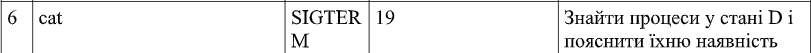

2 Перевірено версію операційної системи Ubuntu, оновлено список пакетів і встановлено потрібні утиліти для роботи з процесами. Створено робочий каталог `lab11` та два скрипти: `cpu_load.sh` для створення навантаження на процесор і `parent_child.sh` для дослідження батьківських та дочірніх процесів.

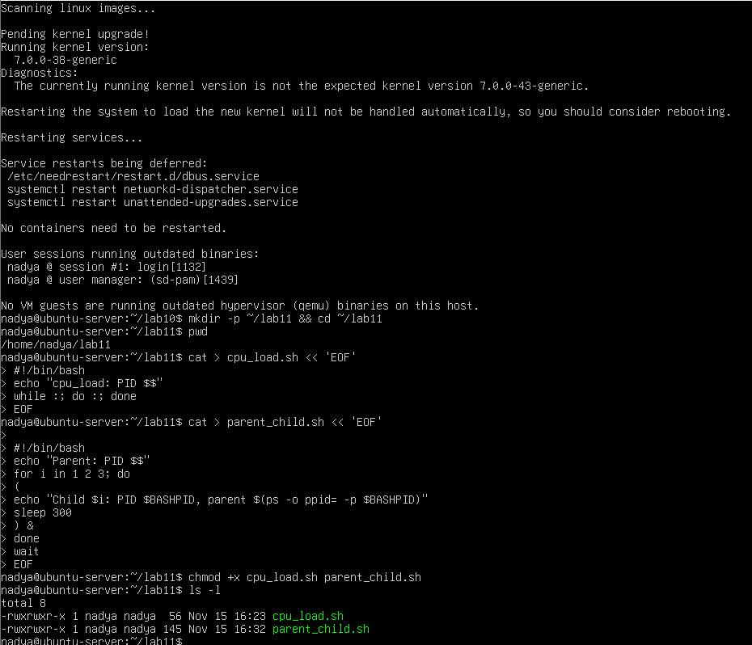

3 Команди перегляду процесів відрізняються набором даних: `ps` показує процеси поточного термінала, а `ps aux` і `ps -ef` виводять усі процеси в системі з різними колонками.

| Команда | Що показує |
| --- | --- |
| `ps` | Процеси поточного термінала |
| `ps aux` | Усі процеси та використання ресурсів |
| `ps -ef` | Усі процеси з PID і PPID |

: Таблиця 1 — Призначення команд перегляду процесів

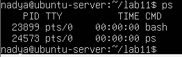

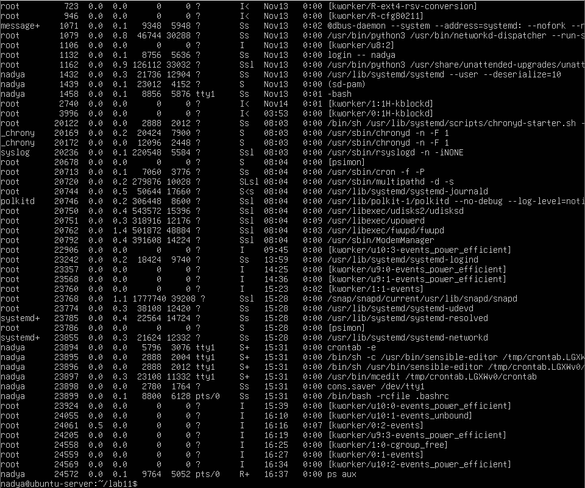

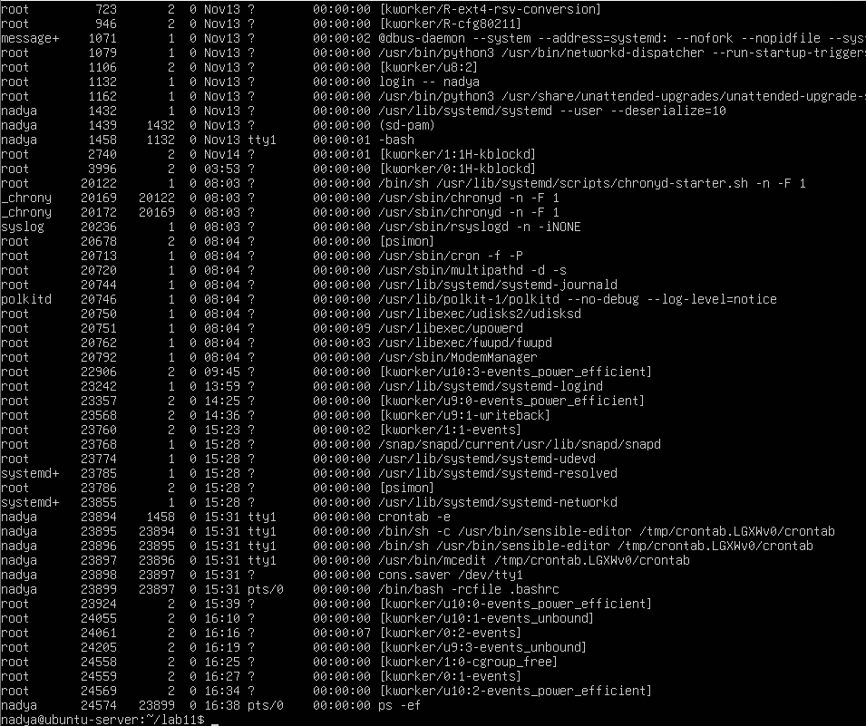

4 Для перегляду ієрархії процесів використано команду `pstree -p`. Під час запуску `parent_child.sh` створено батьківський і три дочірні процеси. У підоболонці змінна `$$` зберігає PID основного процесу, а `$BASHPID` — PID поточного процесу Bash, тому для дочірніх процесів використано `$BASHPID`.

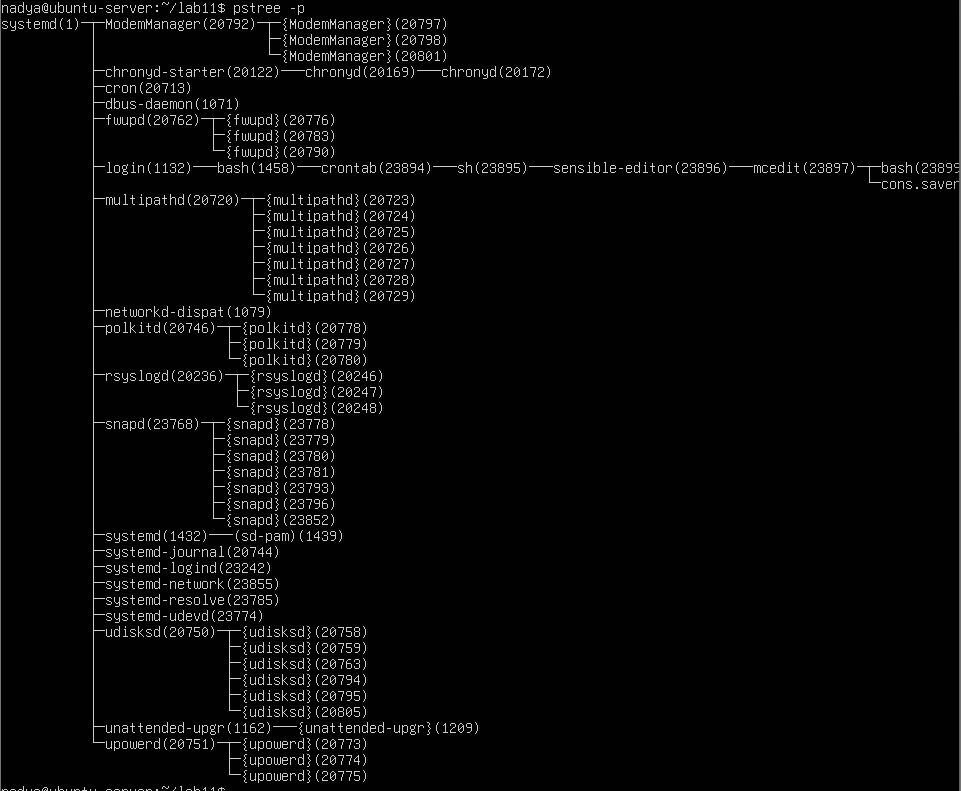

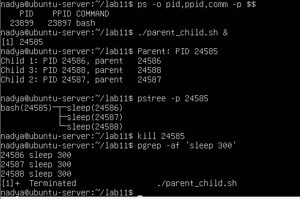

5 Запущено фоновий процес `cat` (читання з `/dev/zero` у `/dev/null`). За допомогою `ps` і `/proc/PID/status` визначено його параметри, після чого процес завершено сигналом `SIGTERM` і перевірено, що він зник зі списку процесів.

| Параметр | Отримане значення |
| --- | --- |
| Назва | `cat` |
| PID | 24606 |
| PPID | 23899 |
| Стан | R |
| Nice | 0 |
| RSS | 7968 |

: Таблиця 2 — Характеристики процесу cat

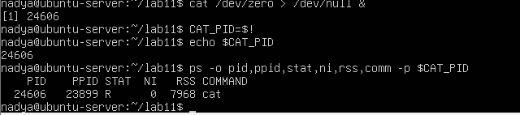

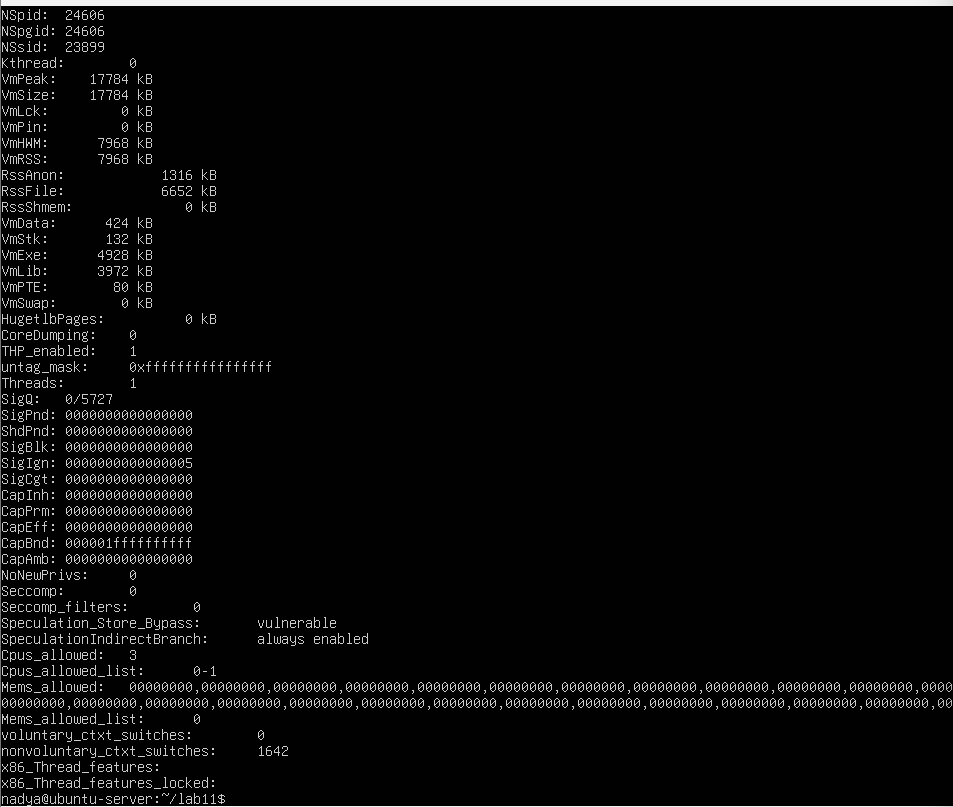

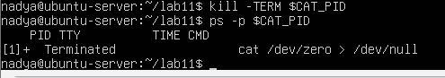

6 Перевірено керування фоновим процесом `cpu_load.sh`: призупинення через `Ctrl+Z`, переведення у фон командою `bg`, повернення на передній план через `fg`, зупинка сигналом `SIGSTOP`, відновлення сигналом `SIGCONT` і завершення через `SIGTERM`.

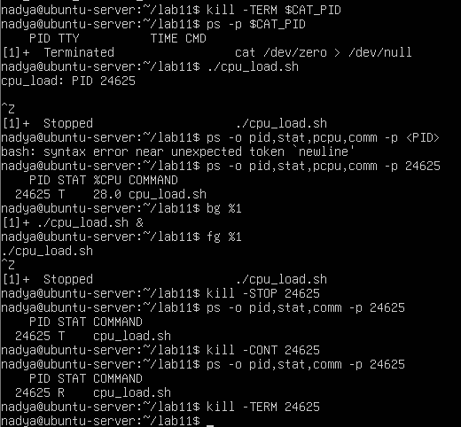

7 Сигнал `SIGTERM` дає змогу коректно завершити процес або перехопити його для виконання дій скрипта, тоді як `SIGKILL` завершує процес примусово без можливості перехоплення чи ігнорування.

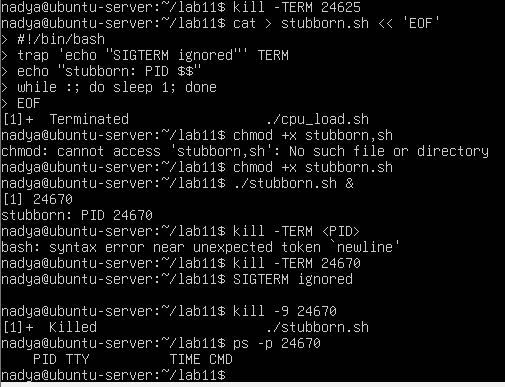

8 За допомогою `taskset` на одному ядрі процесора запущено два процеси з різними значеннями `nice` (0 і 19). Процес із вищим `nice` (19) отримує меншу частку процесорного часу. Під час роботи з `renice` звичайний користувач може підвищувати `nice`, а для зниження потрібні права адміністратора.

| PID | Nice | CPU (%) |
| --- | --- | --- |
| 24766 | 0 | 90.7 |
| 24767 | 19 | 1.3 |

: Таблиця 3 — Порівняння завантаження CPU для процесів із різними значеннями nice

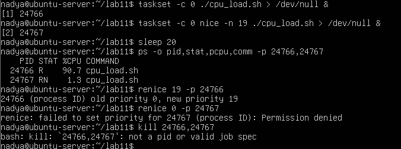

9 Досліджено зомбі-процес (`[sleep] <defunct>`, стан `Z`), який уже завершився, але його статус не забрав батьківський процес, та осиротілий процес (`sleep 120`, PID 24811), який після завершення батьківської оболонки перейшов під `PPID 1`.

| Тип процесу | Команда / стан | Особливість |
| --- | --- | --- |
| Зомбі-процес | `[sleep] <defunct>` (Z) | Завершився, але батьківський процес не забрав статус завершення |
| Осиротілий процес | `sleep 120` (PID 24811) | Батьківська оболонка завершилась, новий батько — `PPID 1` |

: Таблиця 4 — Досліджені зомбі- та осиротілий процеси

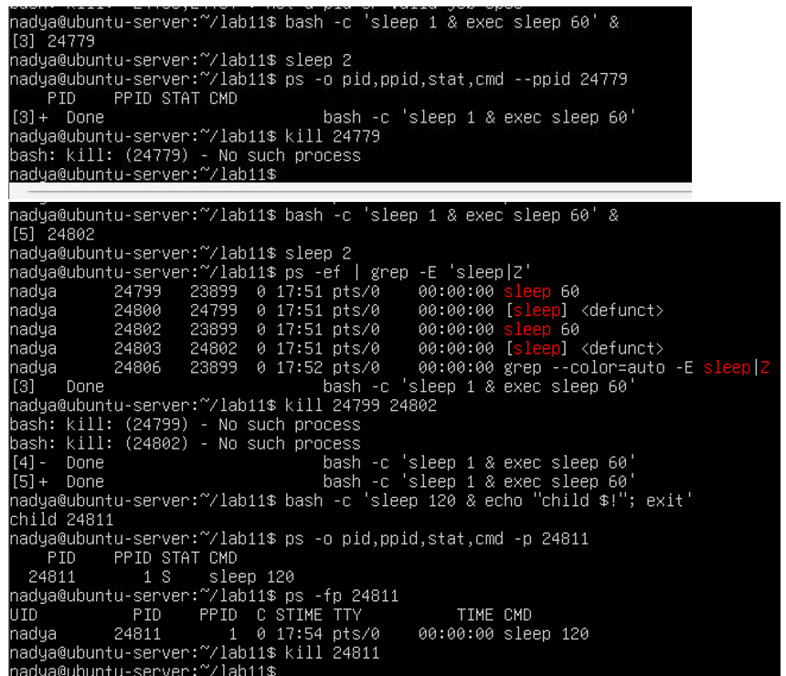

10 У Windows PowerShell переглянуто процеси з найбільшим використанням пам'яті (`Memory Compression`, `chrome`, `Telegram`), запущено `Notepad.exe` (ProcessId = 10808, ParentProcessId = 15540), змінено пріоритет на `BelowNormal` і завершено процес командою `Stop-Process`.

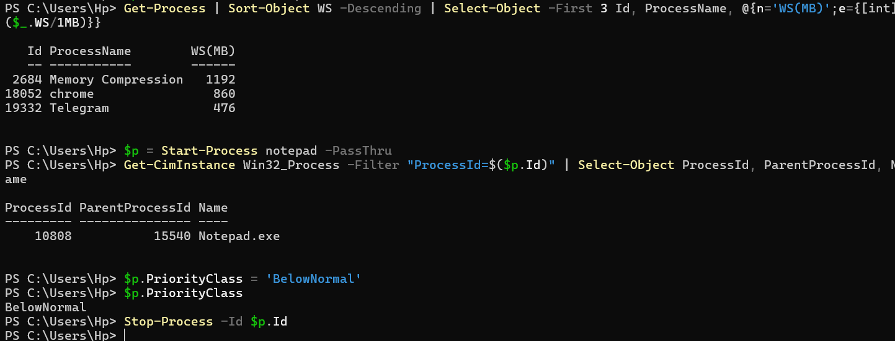

11 Індивідуальне завдання. Виконано пошук процесів у стані `D` через `ps` та `awk` (10 ітерацій з інтервалом 1 секунда). Процесів у стані `D` не виявлено; цей стан означає непереривне очікування завершення операції введення-виведення, під час якого процес не реагує на сигнали, тому його поява залежить від поточної активності пристроїв/диска.

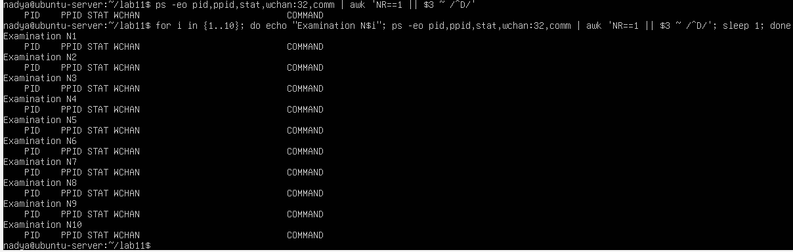

## Відповіді на контрольні питання

### Високий рівень (творчий)

1 Процес не реагує ні на SIGTERM, ні на SIGKILL. Назвіть можливі причини та порядок дій адміністратора.

Основна причина — стан `D` (непереривне очікування, наприклад через операцію введення-виведення, проблему з диском або зависання драйвера/обладнання). Адміністратор перевіряє стан процесу через `ps`, аналізує системні журнали та повідомлення ядра, усуває причину блокування або очікує завершення операції; якщо процес не зникає і заважає роботі, застосовує перезавантаження системи.

2 Сервер періодично «підвисає» під навантаженням. Опишіть, які показники процесів ви перевірите й у якій послідовності.

Спочатку оцінюю загальне завантаження CPU та пам'яті (`top` або `htop`), далі визначаю процеси з найбільшим споживанням процесора і RAM, перевіряю їхні стани (`R`, `S`, `D`, `Z`), пріоритети (`nice`), кількість процесів та наявність зомбі-процесів, а за потреби коригую пріоритети або завершую проблемні процеси.

3 Поясніть, чому кількість zombie-процесів, що зростає, є ознакою помилки в програмі, а не в ядрі.

Зомбі-процес виникає, коли дочірній процес уже завершив роботу, але батьківський процес не зчитав його код завершення. Зростання їх кількості свідчить про те, що батьківська програма не обробляє завершення дочірніх процесів (не викликає `wait()` / обробник `SIGCHLD`), тоді як ядро лише утримує запис до моменту, коли батько забере статус.

4 Сформулюйте критерій, за яким адміністратор обирає між зміною пріоритету процесу та його завершенням. Проілюструйте прикладом.

Зміну пріоритету (`nice` / `renice`) обирають, коли процес легітимний і потрібен, але забирає забагато ресурсів у критичний момент — наприклад, знижують пріоритет фоновому завданню обробки даних. Завершення обирають, коли процес завис, працює з помилками чи порушує стабільність системи — наприклад, зупиняють завислу програму, яка перестала відповідати.

## Висновок

Під час лабораторної роботи закріплено навички моніторингу та керування процесами в Linux і Windows за допомогою `ps`, `pstree`, `/proc`, сигналів `SIGTERM`/`SIGKILL`/`SIGSTOP`/`SIGCONT`, пріоритетів `nice`/`renice` та засобів PowerShell. Це дозволяє своєчасно виявляти причини підвисань і підтримувати стабільну роботу системи.
