<!--
  Управління процесами
  Варіант 7: `tail -f` — SIGHUP — 5 — Скрипт, що завершує процес за іменем із підтвердженням

  Тему, мету й обладнання писати не треба — конвеєр візьме їх із лабораторної.
  Знімки екрана кладіть у assets/, вихідний код — у src/.
  Контрольні питання — лише одного рівня, того, на який захищаєте роботу:
  заголовок «### Достатній рівень», далі «1 Текст питання?» і відповідь.
  Покрокова інструкція — reports/README.md
-->

## Хід роботи

Тема: Управління процесами.

Мета: навчитися переглядати інформацію про процеси в Linux і Windows, керувати ними — запускати, призупиняти й завершувати, змінювати пріоритети, розуміти ієрархію та стани процесів і користуватися засобами моніторингу в реальному часі.

Обладнання: ПК під керуванням ОС Ubuntu 26.04.1 LTS (ядро 7.0, 4 логічних ядра, bash 5.3), утиліти ps, top, htop, pstree, kill, nice, renice, taskset; ПК під керуванням ОС Windows з PowerShell.

Постановка задачі за варіантом 7: процес для дослідження — tail -f; сигнал — SIGHUP; пріоритет nice — 5; індивідуальне завдання — скрипт, що завершує процес за іменем із підтвердженням.

1 Підготовка середовища. Перевірено наявність утиліт htop, pstree (пакет psmisc), taskset, створено робочий каталог ~/lab11 і три навчальні скрипти: cpu_load.sh — нескінченний цикл, що повністю завантажує одне ядро; parent_child.sh — батьківський процес, який запускає три дочірні підоболонки; stubborn.sh — процес, що перехоплює SIGTERM обробником trap. Також створено порожній файл log.txt, за яким стежитиме tail -f.

Під час перевірки скрипта parent_child.sh з методички виявлено помилку: вираз $(ps -o ppid= -p $BASHPID) виконується в окремій підоболонці підстановки команди, тому $BASHPID усередині неї — це PID саме цієї підоболонки, і як «батько» виводився PID дитини. У виправленій версії PID дитини спершу зберігається у змінній me, а вже потім передається в ps:

```bash
#!/bin/bash
echo "Батько: PID $$"
for i in 1 2 3; do
  (
    me=$BASHPID
    echo "Дитина $i: PID $me, батько $(ps -o ppid= -p $me | tr -d ' ')"
    sleep 300
  ) &
done
wait
```

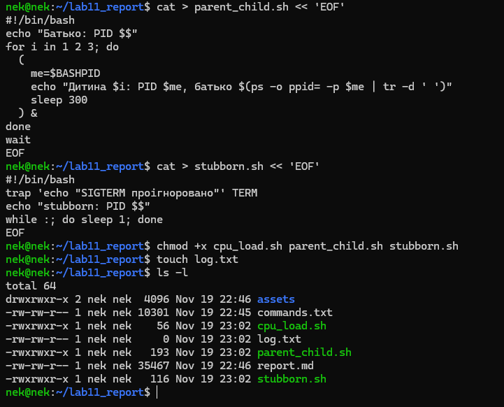

2 Перегляд переліку процесів трьома способами. Команда ps без ключів показує лише процеси поточного терміналу; ps aux (BSD-синтаксис: a — процеси всіх користувачів, u — орієнтований на користувача формат, x — також процеси без терміналу) виводить усі процеси з колонками %CPU, %MEM, VSZ, RSS, STAT, START; ps -ef (POSIX-синтаксис: -e — усі процеси, -f — повний формат) виводить UID, PPID, C, STIME і не показує пам'ять та стан. Команда ps -eo pid,ppid,stat,ni,rss,comm --sort=-rss виводить лише потрібні колонки (-o) і сортує за спаданням RSS, тобто ставить найбільших споживачів пам'яті вгорі.

Таблиця 1 – Порівняння форматів виводу ps

| Команда | Які процеси | Колонки |
|---------|-------------|---------|
| ps | лише поточного терміналу | PID, TTY, TIME, CMD |
| ps aux | усі, зокрема без терміналу | USER, PID, %CPU, %MEM, VSZ, RSS, TTY, STAT, START, TIME, COMMAND |
| ps -ef | усі | UID, PID, PPID, C, STIME, TTY, TIME, CMD |
| ps -eo ... | усі | ті, що задано після -o |

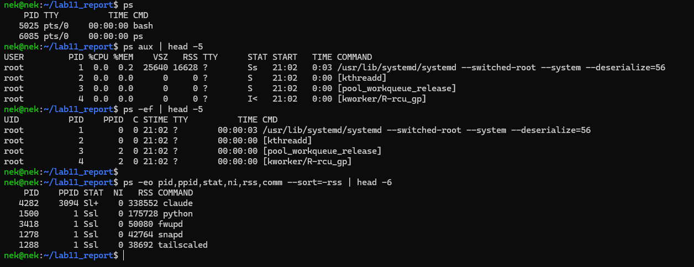

3 Дерево процесів. Команда pstree -ps $$ (-p — показувати PID, -s — показати предків заданого процесу) вивела ланцюжок systemd(1) → sshd → sshd-session → sshd-session → bash, тобто термінал породжено службою SSH: sshd на кожне підключення створює процес sshd-session, а той запускає оболонку bash користувача.

Далі у фоні запущено parent_child.sh і побудовано дерево командою pstree -p $!. Батьківський процес має трьох нащадків, у кожного PPID дорівнює PID батька. У дереві видно процеси sleep, а не копії bash: оскільки sleep 300 — остання команда підоболонки, bash не створює новий процес, а замінює себе програмою sleep (exec), зберігаючи той самий PID. Для PID дитини використано $BASHPID, бо $$ у підоболонці за стандартом POSIX лишається PID-ом головного скрипта. Завершено всі процеси командою kill %1: в інтерактивній оболонці фонове завдання має власну групу процесів, і сигнал отримують батько разом з усіма дітьми.

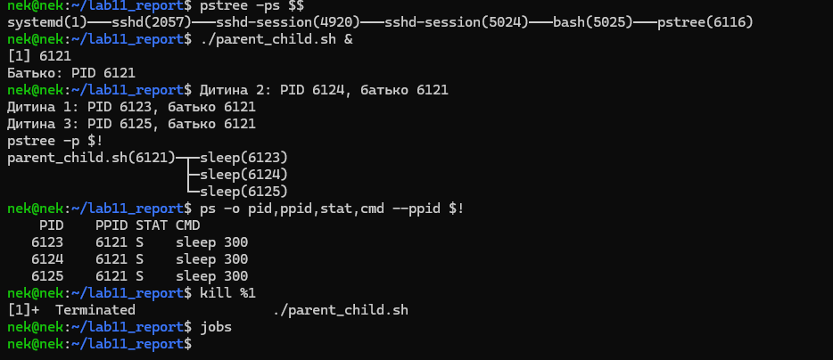

4 Дослідження процесу варіанта tail -f. У фоні запущено tail -f ~/lab11/log.txt і знайдено його командою pgrep -x tail (ключ -x вимагає точного збігу імені; без нього pgrep tail знаходить ще й службу tailscaled). Атрибути процесу визначено двома способами — з ps і з /proc/PID/status.

Таблиця 2 – Атрибути процесу tail -f

| Атрибут | ps | /proc/PID/status |
|---------|----|------------------|
| PID | 4560 | 4560 |
| PPID | 4558 (bash) | PPid: 4558 |
| Стан | Sl | State: S (sleeping) |
| nice / PRI | 0 / 19 | — |
| Пам'ять RSS | 7920 КБ | VmRSS: 7920 kB |
| Віртуальна пам'ять | VSZ 85400 КБ | VmSize: 85400 kB |
| Потоки | NLWP 2 | Threads: 2 |

Стан Sl означає, що процес спить (очікує появи нових даних у файлі) і має кілька потоків. У Ubuntu 26.04 утиліту tail реалізовано в uutils coreutils (Rust), тому вона двопотокова, на відміну від класичної GNU-версії. Файл /proc/PID/wchan показав futex_do_wait — потік чекає на м'ютексі, а каталог /proc/PID/fd — відкриті дескриптори: файл log.txt і inotify, через який ядро повідомляє tail про зміни файлу.

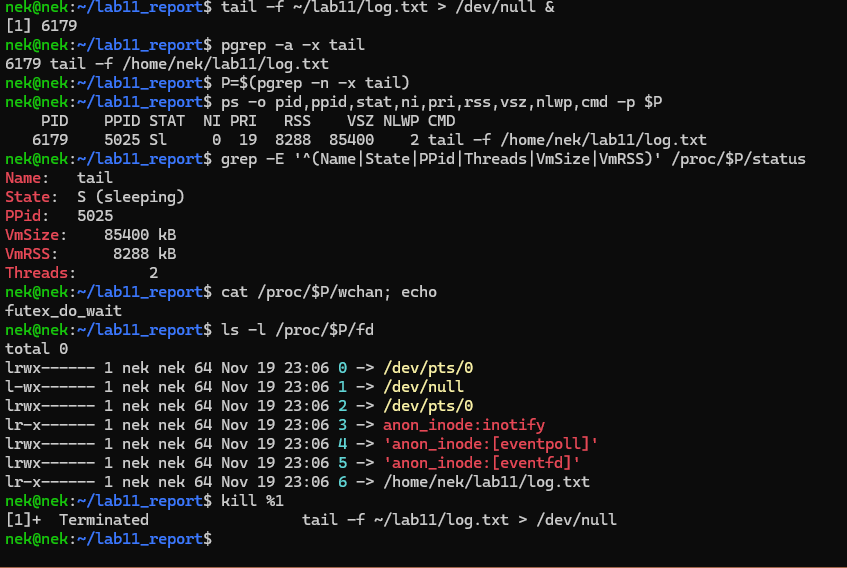

5 Фонові завдання і сигнали. tail -f запущено на передньому плані й призупинено комбінацією Ctrl+Z (сигнал SIGTSTP) — стан змінився на Tl, jobs показує Stopped. Команда bg %1 продовжила його у фоні (Running), fg %1 повернула на передній план, повторний Ctrl+Z і bg %1 знову перевели у фон. Сигнал kill -STOP %1 зупинив процес (jobs: Stopped (signal), стан T), kill -CONT %1 продовжив його (стан S). Наостанок процес завершено сигналом варіанта kill -HUP %1, оболонка повідомила Hangup. Код завершення процесу — 129 = 128 + 1, де 1 — номер SIGHUP.

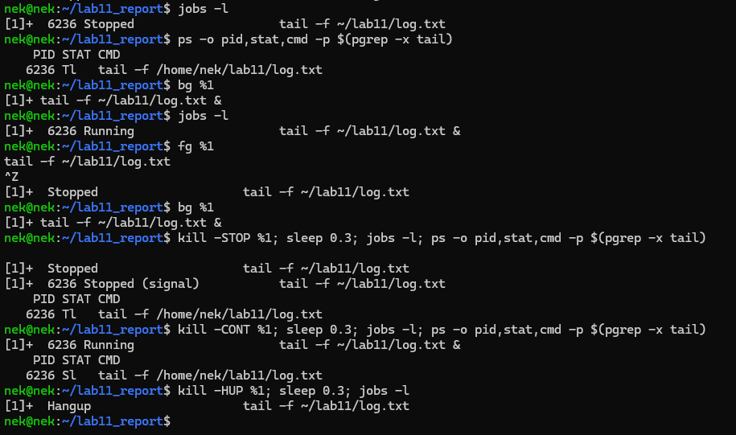

6 Порівняння SIGTERM і SIGKILL. Запущено stubborn.sh, у якому trap перехоплює SIGTERM. Після kill %1 скрипт вивів «SIGTERM проігноровано» і продовжив роботу. Після kill -9 %1 процес негайно знищено, оболонка повідомила Killed (код завершення 137 = 128 + 9).

Таблиця 3 – Порівняння сигналів SIGTERM і SIGKILL

| Ознака | SIGTERM (15) | SIGKILL (9) |
|--------|--------------|-------------|
| Команда | kill PID | kill -9 PID |
| Хто обробляє | програма (можна встановити обробник) | ядро, програму не питають |
| Чи можна перехопити або ігнорувати | так | ні |
| Результат для stubborn.sh | «SIGTERM проігноровано», процес працює | Killed, процес знищено |
| Збереження даних | програма може закрити файли й зберегти стан | незбережені дані втрачаються |

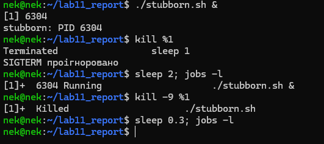

7 Пріоритети на одному ядрі. Два процеси cpu_load.sh запущено з прив'язкою до ядра 0 (taskset -c 0), один зі звичайним пріоритетом, другий — з nice 5 за варіантом (nice -n 5). Через 15 секунд top -b -n 2 -d 3 (пакетний режим, дві ітерації з інтервалом 3 с; береться друга, бо перша показує середнє з моменту запуску) показав розподіл процесорного часу. Колонка PSR підтверджує, що обидва процеси працюють на ядрі 0, а STAT RN — що другий має знижений пріоритет.

Таблиця 4 – Частки CPU за різних значень nice (одне ядро)

| Процес | NI | PR у top | %CPU | Теоретична частка |
|--------|----|----------|------|-------------------|
| cpu_load.sh №1 | 0 | 20 | 75,3 | 1024 / (1024 + 335) = 75 % |
| cpu_load.sh №2 | 5 | 25 | 24,7 | 335 / (1024 + 335) = 25 % |
| cpu_load.sh №1 | 0 | 20 | 90,0 | 1024 / (1024 + 110) = 90 % |
| cpu_load.sh №2 (після renice) | 10 | 30 | 9,6 | 110 / (1024 + 110) = 10 % |

Отримані частки збігаються з вагами планувальника: кожен крок nice змінює вагу приблизно в 1,25 раза, тому nice 5 дає вагу 335 проти 1024.

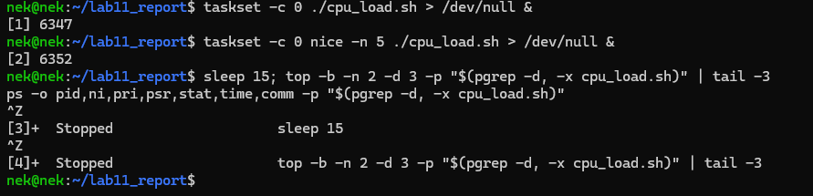

8 Зміна пріоритету запущеного процесу. Команда renice -n 10 -p PID збільшила nice другого процесу з 5 до 10, і його частка CPU впала до 9,6 %. Спроба повернути nice до 0 командою renice -n 0 -p PID завершилася помилкою Permission denied: зменшувати nice, тобто підвищувати пріоритет, може лише root (можливість CAP_SYS_NICE). Інакше будь-який користувач міг би підняти пріоритет своїх процесів і відібрати процесорний час в інших. Процеси завершено командою pkill -x cpu_load.sh.

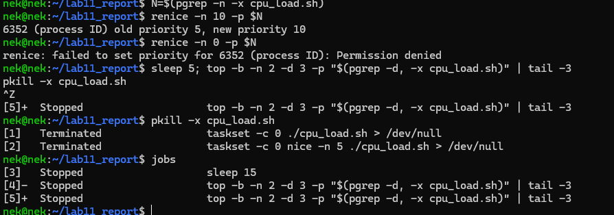

9 Зомбі-процес. Команда bash -c 'sleep 1 & exec sleep 60' & запускає дочірній sleep 1, а потім замінює оболонку програмою sleep 60, яка ніколи не викликає wait(). Через 2 секунди ps -o pid,ppid,stat,cmd --ppid $! показав дитину в стані Z з позначкою [sleep] <defunct>. Після завершення батька (kill %1) зомбі перейшов до нового батька, який прочитав його код повернення, і зник із таблиці процесів.

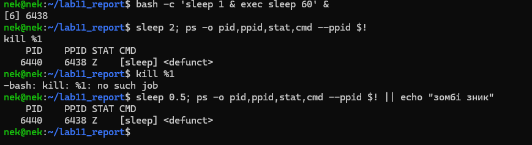

10 Осиротілий процес. Команда bash -c 'sleep 120 & echo "дитина $!"; exit' запустила sleep 120 і одразу завершила батьківську оболонку. ps показав, що PPID сироти дорівнює 1, тобто її всиновив systemd (PID 1). Робота виконувалася через SSH, тому в ланцюжку предків немає systemd --user, який у графічному сеансі Ubuntu є subreaper-ом і став би новим батьком.

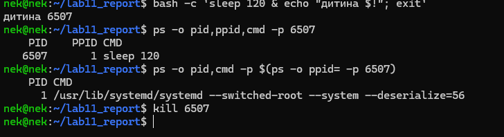

11 Процеси у Windows. У PowerShell отримано п'ять процесів з найбільшим робочим набором (Get-Process | Sort-Object WS -Descending), перелік командою tasklist, запущено notepad з -PassThru, щоб отримати об'єкт процесу, визначено його батька через Get-CimInstance Win32_Process (ParentProcessId збігається з $PID сеансу PowerShell), змінено клас пріоритету на BelowNormal і завершено процес командою Stop-Process.

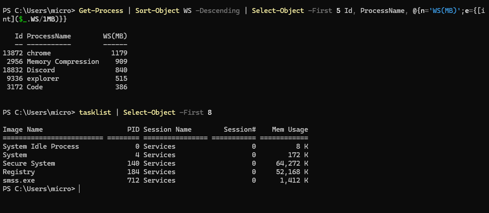

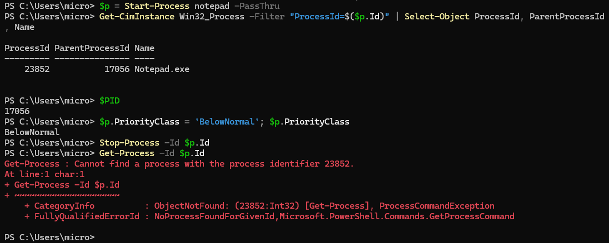

Таблиця 5 – Порівняння засобів керування процесами в Linux і Windows

| Дія | Linux | Windows |
|-----|-------|---------|
| Перелік процесів | ps aux, ps -ef | Get-Process, tasklist |
| Пам'ять процесу | RSS | WS (Working Set) |
| Батьківський процес | ps -o ppid= -p PID, pstree | Win32_Process → ParentProcessId |
| Дерево процесів | підтримується, сироти всиновлюються | лише збережений PPID, сирот ніхто не всиновлює |
| Коректне завершення | kill PID (SIGTERM) | taskkill /pid PID (WM_CLOSE) |
| Примусове завершення | kill -9 PID (SIGKILL) | Stop-Process -Force, taskkill /f (TerminateProcess) |
| Пріоритет | nice від −20 до +19 | класи Idle … RealTime |
| Монітор у реальному часі | top, htop | диспетчер задач, resmon |

12 Індивідуальне завдання: скрипт kill_by_name.sh, що завершує процес за іменем із підтвердженням. Скрипт приймає ім'я процесу і необов'язковий сигнал (типово SIGTERM), перевіряє коректність аргументів, шукає процеси поточного користувача з точним збігом імені (pgrep -x -u $USER), показує їх таблицею і для кожного окремо запитує підтвердження. Відповідь читається з /dev/tty, тому скрипт працює коректно навіть у конвеєрі. Якщо через секунду процес ще живий (kill -0 перевіряє існування), скрипт пропонує завершити його примусово сигналом SIGKILL.

```bash
#!/bin/bash
# Завершення процесу за іменем із підтвердженням
# Використання: ./kill_by_name.sh ІМ'Я [СИГНАЛ]   (типово SIGTERM)
name=$1
sig=${2:-TERM}

if [ -z "$name" ]; then
    echo "Використання: $0 ім'я_процесу [сигнал]"
    exit 1
fi
if ! kill -l "$sig" > /dev/null 2>&1; then
    echo "Невідомий сигнал: $sig"
    exit 1
fi

# -x: точний збіг імені, -u: лише процеси поточного користувача
pids=$(pgrep -x -u "$USER" -- "$name")
if [ -z "$pids" ]; then
    echo "Процесів з іменем '$name' не знайдено"
    exit 1
fi

echo "Знайдено процеси '$name':"
ps -o pid,ppid,stat,ni,rss,etime,args -p "$(echo $pids | tr ' ' ',')"
echo

for pid in $pids; do
    read -r -p "Надіслати SIG${sig#SIG} процесу $pid ($(ps -o args= -p $pid))? [y/N] " ans < /dev/tty
    case $ans in
        [yYтТ]*)
            kill -s "${sig#SIG}" "$pid"
            sleep 1
            if kill -0 "$pid" 2>/dev/null; then
                read -r -p "Процес $pid досі працює. Завершити примусово (SIGKILL)? [y/N] " ans < /dev/tty
                case $ans in
                    [yYтТ]*) kill -9 "$pid" && echo "Процес $pid знищено (SIGKILL)" ;;
                    *)       echo "Процес $pid залишено" ;;
                esac
            else
                echo "Процес $pid завершено"
            fi
            ;;
        *)
            echo "Процес $pid пропущено"
            ;;
    esac
done
```

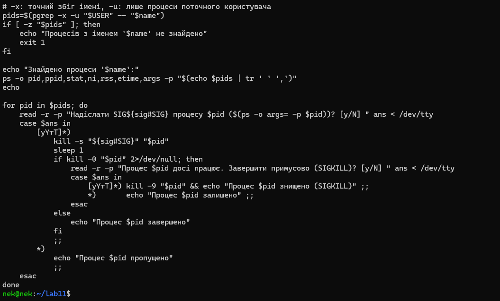

Скрипт перевірено у трьох сценаріях: два процеси tail -f і сигнал варіанта SIGHUP — на перший відповідь y (процес завершено), на другий n (процес пропущено); stubborn.sh, який ігнорує SIGTERM, — скрипт виявив, що процес живий, і після підтвердження знищив його через SIGKILL; помилкові виклики — неіснуючий процес, відсутній аргумент, невідомий сигнал.

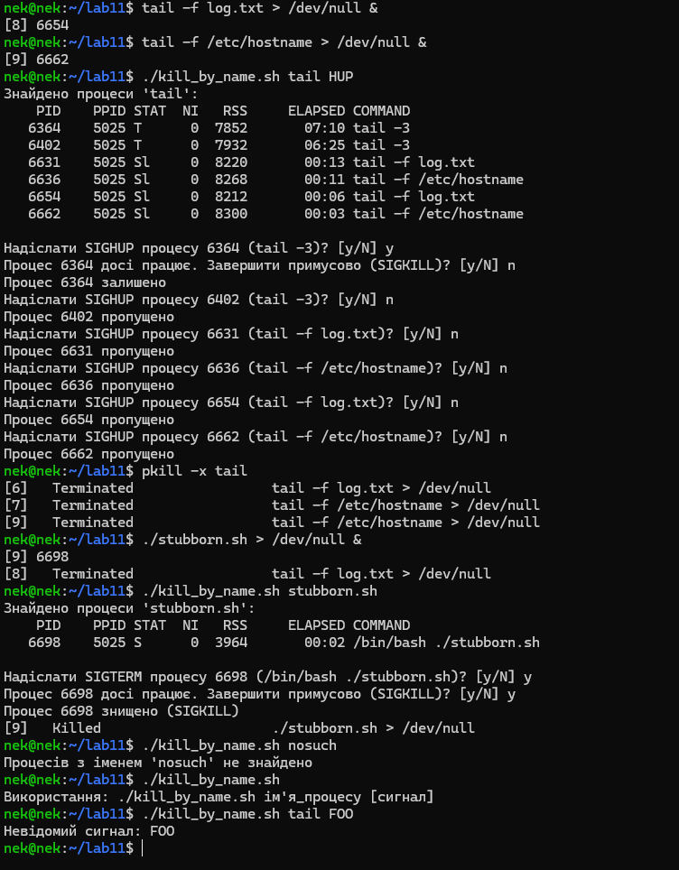

Таблиця 6 – Перелік досліджених процесів

| Процес | PID | PPID | Стан | nice | RSS, КБ |
|--------|-----|------|------|------|---------|
| systemd | 1 | 0 | Ss | 0 | 16620 |
| sshd | 2057 | 1 | Ss | 0 | 7828 |
| tailscaled | 1288 | 1 | Ssl | 0 | 38352 |
| tail -f log.txt | 4560 | 4558 | Sl | 0 | 7920 |
| cpu_load.sh | 4874 | 4873 | R | 0 | 3932 |
| cpu_load.sh (nice 5) | 4875 | 4873 | RN | 5 | 3900 |
| stubborn.sh | 4876 | 4873 | S | 0 | 3996 |
| sleep (зомбі) | 4658 | 4656 | Z | 0 | 0 |

## Відповіді на контрольні питання

### Високий рівень

1 Процес не реагує ні на SIGTERM, ні на SIGKILL. Назвіть можливі причини та порядок дій адміністратора.

Причини: процес у стані D чекає завершення вводу-виводу (завислий диск, недоступна NFS, збій драйвера); процес уже є зомбі й чекає wait() від батька; процес зупинений сигналом SIGSTOP і буде завершено лише після SIGCONT; сигнал надіслано не тому PID або без прав. Порядок дій: перевірити стан (ps -o pid,ppid,stat,wchan -p PID), для Z — розібратися з батьком; для D — переглянути /proc/PID/wchan, /proc/PID/stack, dmesg, стан дисків і мережевих монтувань і усунути причину (відновити пристрій чи мережу, umount -f/-l); якщо причина в ядрі чи драйвері — запланувати перезавантаження.

2 Сервер періодично «підвисає» під навантаженням. Опишіть, які показники процесів ви перевірите й у якій послідовності.

Спершу load average і розподіл часу CPU в top (us, sy, wa, st) — це покаже, чи бракує процесора, чи система чекає диск. Далі процеси, відсортовані за %CPU, і кількість процесів у стані R та D. Потім пам'ять: free, RSS процесів, використання swap, записи OOM killer у dmesg. Потім ввід-вивід: iostat, iotop, процеси в стані D. Наостанок кількість процесів, потоків і зомбі, відкриті дескриптори та журнали (journalctl), щоб зіставити час підвисання з подіями.

3 Поясніть, чому кількість zombie-процесів, що зростає, є ознакою помилки в програмі, а не в ядрі.

Ядро свою частину виконує: після завершення дитини воно зберігає її код повернення й надсилає батьку SIGCHLD. Прибрати зомбі має батько викликом wait() або waitpid(). Якщо кількість зомбі зростає, батьківська програма не обробляє SIGCHLD і не викликає wait(), тобто помилка в її коді. Після завершення такого батька зомбі одразу прибере новий батько, що підтверджує: ядро працює правильно.

4 Сформулюйте критерій, за яким адміністратор обирає між зміною пріоритету процесу та його завершенням. Проілюструйте прикладом.

Якщо процес виконує корисну роботу, але заважає іншим, слід знизити пріоритет (renice, ionice); якщо процес некоректний (завис, зациклився, споживає ресурси без результату) або вже загрожує стабільності системи, його завершують — спершу SIGTERM, потім SIGKILL. Приклад: нічне резервне копіювання вдень сповільнює вебсервер — йому ставлять nice 10 і ionice -c3, і копія завершиться без шкоди для користувачів. А скрипт, що в нескінченному циклі породжує процеси й вичерпує пам'ять, треба завершити, бо результату від нього не буде.

## Висновок

Під час лабораторної роботи опановано перегляд процесів командами ps у різних форматах, pstree, top і через віртуальну ФС /proc; визначено атрибути процесу tail -f (PID, PPID, стан Sl, nice, RSS, потоки) та з'ясовано, що в Ubuntu 26.04 він двопотоковий. Відпрацьовано керування завданнями оболонки (&, Ctrl+Z, jobs, bg, fg) і сигналами SIGSTOP, SIGCONT, SIGHUP, SIGTERM, SIGKILL; на практиці показано, що SIGTERM програма може перехопити, а SIGKILL — ні. Експеримент на одному ядрі підтвердив вплив nice: процес з nice 5 отримав 25 % CPU, з nice 10 — 10 %, а зменшити nice без root неможливо. Відтворено зомбі-процес і сироту та визначено, що через SSH сироту всиновлює PID 1. Порівняно засоби керування процесами в Linux і Windows. Написано скрипт kill_by_name.sh, що завершує процеси за іменем із підтвердженням і за потреби пропонує SIGKILL. Також виявлено й виправлено помилку зі змінною $BASHPID у навчальному скрипті. Отже, адміністратор діагностує проблеми з процесами за допомогою ps, top, pstree і /proc, а усуває їх сигналами, зміною пріоритету та роботою з батьківськими процесами.
