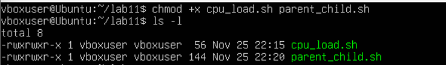
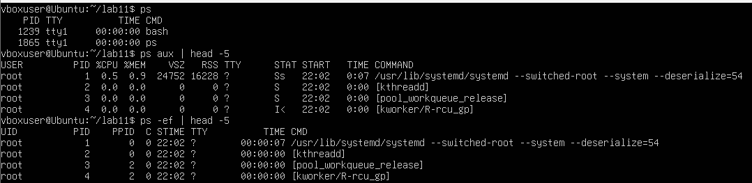
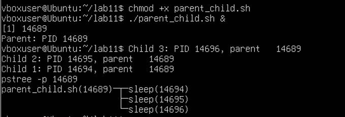
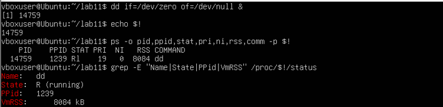
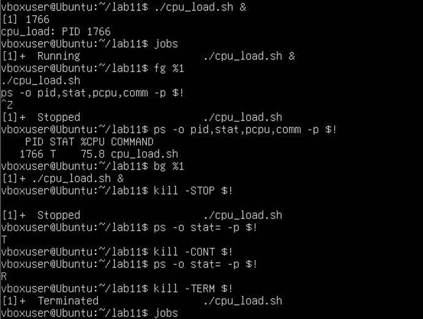
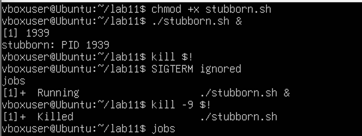
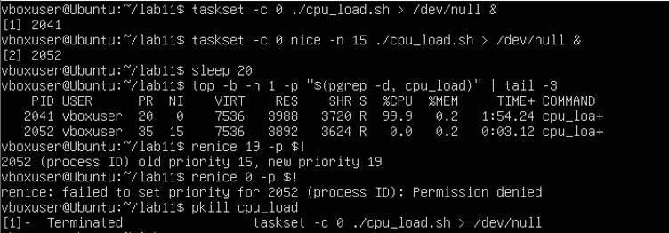
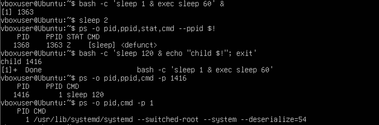
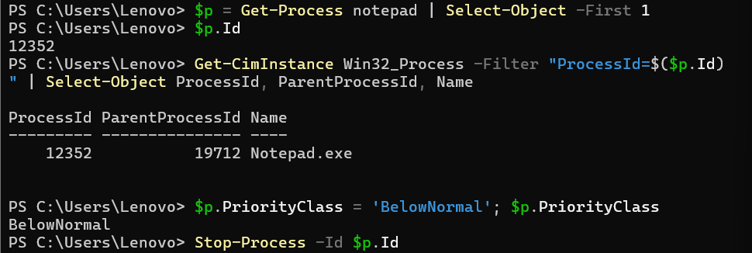
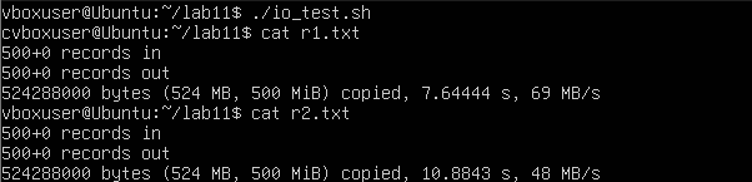

<!--
  Управління процесами
  Варіант 11: `dd` — SIGTERM — 15 — Оцінити вплив nice на процес, що активно працює з диском

  Тему, мету й обладнання писати не треба — конвеєр візьме їх із лабораторної.
  Знімки екрана кладіть у assets/, вихідний код — у src/.
  Контрольні питання — лише одного рівня, того, на який захищаєте роботу:
  заголовок «### Достатній рівень», далі «1 Текст питання?» і відповідь.
  Покрокова інструкція — reports/README.md
-->

## Хід роботи

1 Отримала в викладача номер індивідуального варіанта 11.

2 Підготувала середовище для роботи у віртуальній машині з ОС Ubuntu. Командою sudo apt update оновила список пакетів, а командою sudo apt install -y htop stress-ng psmisc встановила утиліти htop, stress-ng та пакет psmisc, до складу якого входять pstree і killall. Командою mkdir -p \~/lab11 && cd \~/lab11 створила робочий каталог \~/lab11 і перейшла в нього. Командою cat створила два навчальні скрипти: cpu_load.sh, який виводить свій PID і навантажує процесор порожнім нескінченним циклом, та parent_child.sh, який створює три дочірні процеси. Командою chmod +x cpu_load.sh parent_child.sh надала скриптам право на виконання. Командою ls -l перевірила результат: файли cpu_load.sh (56 байт) і parent_child.sh (144 байти) мають права -rwxrwxr-x, власник і група vboxuser, отже обидва скрипти готові до запуску.

3 Отримала перелік процесів трьома способами. Командою ps вивела лише процеси поточного термінала tty1: bash (PID 1239) та саму команду ps (PID 1865). Тут є тільки колонки PID (ідентифікатор процесу), TTY (термінал), TIME (витрачений процесорний час) і CMD (назва команди). Командою ps aux | head -5 вивела перші рядки переліку всіх процесів системи. Тут є колонки USER (власник), PID, %CPU та %MEM (частка процесора й пам'яті), VSZ (віртуальна пам'ять у КБ), RSS (фізична пам'ять у КБ), TTY, STAT (стан), START (час запуску), TIME і COMMAND (повний командний рядок). Наприклад, процес systemd (PID 1, власник root) мав %CPU 0.5, %MEM 0.9 і стан Ss, тобто сплячий лідер сеансу. Командою ps -ef | head -5 також вивела перші рядки переліку всіх процесів, але з колонками UID, PID, PPID (ідентифікатор батьківського процесу), C (використання процесора), STIME (час запуску), TTY, TIME і CMD. Наприклад, процеси з PID 3 і 4 мають PPID 2, тобто їх породив kthreadd. Отже, ps показує лише процеси поточного термінала, ps aux зручна для аналізу використання ресурсів і станів, а ps -ef дає змогу побачити батьківські зв'язки між процесами. Знак ? у колонці TTY означає, що процес не пов'язаний із терміналом.

4 Побудувала дерево процесів командою pstree -p, коренем дерева є systemd (PID 1). Командою echo \$\$ визначила PID своєї оболонки bash: 1239. Командою pstree -s -p \$\$ переглянула її батьківські процеси: systemd(1), login(872), bash(1239). Отже, мій термінал породив процес login з PID 872. Запустила скрипт командою ./parent_child.sh &. Батьківський процес отримав PID 14689, а три дочірні процеси PID 14694, 14695 і 14696. Командою pstree -p 14689 перевірила, що всі три процеси sleep є нащадками parent_child.sh. Для PID дитини використано \$BASHPID, а не \$\$, тому що в підоболонці \$\$ містить PID батьківського скрипта, а \$BASHPID містить власний PID підоболонки. Щоб правильно визначити батька, зберегла власний PID у змінну me, оскільки всередині \$( ) значення \$BASHPID змінюється. У результаті для всіх трьох дітей визначився батько 14689.

5 Запустила процес свого варіанта у фоновому режимі командою dd if=/dev/zero of=/dev/null &. Командою echo \$! визначила його PID: 14759. Командою ps -o pid,ppid,stat,pri,ni,rss,comm -p \$! отримала відомості про процес: PID 14759, PPID 1239 (моя оболонка bash), стан R, пріоритет PRI 19, значення nice 0, обсяг фізичної пам'яті RSS 8084 КБ. Командою grep -E "Name|State|PPid|VmRSS" /proc/\$!/status перевірила ці дані у файлі /proc/14759/status: Name dd, State R (running), PPid 1239, VmRSS 8084 kB. Дані з ps і /proc збігаються. Стан R означає, що процес виконується або готовий до виконання.

6 Запустила навчальний скрипт у фоновому режимі командою ./cpu_load.sh &, він отримав номер завдання 1 і PID 1766. Командою jobs перевірила, що завдання має стан Running. Командою fg %1 перевела його на передній план, після чого натиснула Ctrl+Z, і процес зупинився (Stopped). Командою ps -o pid,stat,pcpu,comm -p \$! визначила, що процес має стан T, тобто зупинений, а %CPU дорівнює 75.8, оскільки це середнє значення за весь час життя процесу. Командою bg %1 продовжила виконання скрипта у фоновому режимі. Командою kill -STOP \$! зупинила процес сигналом SIGSTOP, команда ps -o stat= -p \$! показала стан T. Командою kill -CONT \$! продовжила процес сигналом SIGCONT, після чого його стан змінився на R, тобто він знову виконується. Командою kill -TERM \$! завершила процес сигналом SIGTERM, зазначеним у моєму варіанті, і отримала повідомлення Terminated. Повторна команда jobs нічого не вивела, отже фонових завдань не залишилося.

7 Створила в редакторі nano скрипт stubborn.sh, який за допомогою команди trap перехоплює сигнал SIGTERM. Командою `chmod +x stubborn.sh` надала йому право на виконання та запустила у фоні командою `./stubborn.sh &`, процес отримав PID 1939. Командою `kill $!` надіслала йому сигнал SIGTERM: з'явилося повідомлення SIGTERM ignored, а команда jobs показала, що процес продовжує працювати (Running). Потім командою `kill -9 $!` надіслала сигнал SIGKILL, і процес був завершений (Killed), що підтвердив порожній вивід jobs. Отже, різниця в тому, що SIGTERM програма може перехопити, обробити або проігнорувати, тому вона має змогу зберегти дані й коректно завершитися. SIGKILL перехопити неможливо, його виконує ядро, тому процес завершується негайно, а незбережені дані втрачаються.

8 Командами taskset -c 0 ./cpu_load.sh > /dev/null & та taskset -c 0 nice -n 15 ./cpu_load.sh > /dev/null & запустила на одному ядрі два процеси навантаження: перший зі значенням nice 0 (PID 2041), другий зі значенням nice 15 за моїм варіантом (PID 2052). Після очікування командою sleep 20 переглянула їх командою top -b -n 1 -p "\$(pgrep -d, cpu_load)" | tail -3. Перший процес мав PR 20, NI 0, %CPU 99.9, TIME+ 1:54.24, а другий PR 35, NI 15, %CPU 0.0, TIME+ 0:03.12. Отже, під час змагання за одне ядро процес із більшим значенням nice отримує значно менше процесорного часу. За теорією співвідношення ваг для nice 0 і nice 15 становить 1024 до 36, тобто приблизно 97 % і 3 %; значення 0.0 є результатом одноразового замірювання top. Командою renice 19 -p \$! змінила пріоритет уже запущеного другого процесу з 15 на 19. Команда renice 0 -p \$! завершилася помилкою Permission denied, тому що зменшення значення nice підвищує пріоритет процесу, і це дозволено лише root, щоб звичайний користувач не міг забрати процесорний час в інших процесів. Командою pkill cpu_load завершила обидва процеси.

9 Відтворила зомбі-процес командою `bash -c 'sleep 1 & exec sleep 60' &`, батьківський процес отримав PID 1363. Через дві секунди командою `ps -o pid,ppid,stat,cmd --ppid $!` побачила дочірній процес із PID 1368, PPID 1363, станом Z і назвою `[sleep] <defunct>`. Це зомбі: процес уже завершився, але батько, який командою exec замінив себе на sleep 60, не викликає wait(), тому запис про дитину залишається в таблиці процесів. Потім командою `bash -c 'sleep 120 & echo "child $!"; exit'` створила осиротілий процес: батьківська оболонка одразу завершилася, а дочірній процес sleep 120 із PID 1416 продовжив працювати. Командою `ps -o pid,ppid,cmd -p 1416` визначила, що його PPID став 1. Командою `ps -o pid,cmd -p 1` перевірила, що це процес `/usr/lib/systemd/systemd`. Отже, у моїй системі новим батьком сироти став systemd з PID 1, оскільки я працюю в текстовій консолі без графічного сеансу.

10 У Windows PowerShell командою Get-Process | Sort-Object WS -Descending | Select-Object -First 3 переглянула три процеси, що займають найбільше пам'яті: VirtualBoxVM (PID 7004, 1175 МБ), chrome (PID 21616, 510 МБ) і Memory Compression (PID 3456, 473 МБ). Спочатку запустила Блокнот командою Start-Process notepad -PassThru, але у Windows 11 запущений таким чином процес (PID 19712) одразу завершився, тому відкрила Блокнот вручну й отримала його процес командою Get-Process notepad. Його PID 12352. Командою Get-CimInstance Win32_Process визначила батьківський процес: ParentProcessId 19712, Name Notepad.exe. Процес із PID 19712 уже завершився, отже Windows зберігає старий PID батька й не призначає сироті нового, на відміну від Linux. Командою \$p.PriorityClass = 'BelowNormal' змінила клас пріоритету процесу і перевірила, що він став BelowNormal. Командою Stop-Process -Id \$p.Id завершила процес, і Блокнот закрився.

11 Виконала індивідуальне завдання: оцінила вплив nice на процес, що активно працює з диском. Створила скрипт io_test.sh, який одночасно запускає на одному ядрі (taskset -c 0) два процеси dd: перший зі значенням nice 0, другий зі значенням nice 15. Кожен записує на диск файл обсягом 500 МіБ з параметром oflag=direct, тобто минаючи кеш, а результати зберігаються у файли r1.txt і r2.txt. Командами cat r1.txt і cat r2.txt переглянула результати. Процес із nice 0 записав 524288000 байт за 7.64444 с зі швидкістю 69 МБ/с, а процес із nice 15 за 10.8843 с зі швидкістю 48 МБ/с. Отже, процес із nice 15 працював повільніше, але різниця приблизно в 1,4 раза набагато менша, ніж у пункті 8, де процеси лише навантажували процесор. Це пояснюється тим, що nice визначає частку процесорного часу, а не пріоритет доступу до диска. Процес dd більшу частину часу чекає завершення операцій введення-виведення, тому вплив nice на нього слабший. Це результат одного замірювання у віртуальній машині, де швидкість диска може коливатися. Для керування пріоритетом введення-виведення в Linux існує окрема команда ionice.

12 Оформила звіт і зробила висновок.

## Відповіді на контрольні питання

### Високий рівень (творчий)

1 Процес не реагує ні на SIGTERM, ні на SIGKILL. Назвіть можливі причини та порядок дій адміністратора.

Найчастіше причина в тому, що процес перебуває у стані D (uninterruptible sleep): він чекає всередині ядра завершення операції введення-виведення, наприклад через несправний диск або недоступний мережевий ресурс NFS, і не реагує навіть на SIGKILL, доки операція не завершиться. Інша причина: процес уже є зомбі (стан Z), тобто завершувати нічого, залишився тільки запис у таблиці процесів. Також сигнал може не діяти, якщо в користувача немає прав на чужий процес, якщо це потік ядра або якщо служба одразу перезапускає процес з новим PID. Спочатку адміністратор перевіряє PID, стан і власника командою ps та дивиться /proc/PID/status і /proc/PID/wchan, щоб зрозуміти, чого чекає процес. Для стану D треба переглянути журнал ядра командою dmesg і усунути проблему з диском або мережею. Для зомбі потрібно змусити батька викликати wait() або завершити батьківський процес. Якщо процес перезапускає служба, її зупиняють командою systemctl stop. Перезавантаження системи є крайнім заходом, коли інші способи не допомогли.

2 Сервер періодично «підвисає» під навантаженням. Опишіть, які показники процесів ви перевірите й у якій послідовності.

Спочатку я перевірю загальне навантаження командою uptime або top і порівняю load average з кількістю ядер. Потім подивлюся, які процеси найбільше займають процесор (%CPU), і яка частка часу йде на очікування введення-виведення (wa). Далі перевірю пам'ять: обсяг вільної пам'яті, використання swap і процеси з найбільшим RSS, оскільки нестача пам'яті та активний свопінг сильно сповільнюють систему. Після цього перегляну стани процесів: багато процесів у стані R свідчить про нестачу процесора, у стані D про проблеми з диском або мережею, а велика кількість Z про помилку в якійсь програмі. Для підозрілих процесів визначу PPID, значення nice, кількість потоків і відкритих файлів. Оскільки зависання періодичне, важливо спостерігати за цими показниками саме в момент проблеми або записувати їх через рівні проміжки часу, а потім зіставити з системними журналами та запланованими завданнями.

3 Поясніть, чому кількість zombie-процесів, що зростає, є ознакою помилки в програмі, а не в ядрі.

Зомбі є нормальним короткочасним станом: після завершення дочірнього процесу ядро зберігає запис про нього з кодом повернення, доки батько не прочитає його викликом wait(). Тобто ядро діє правильно і чекає на батьківський процес. Якщо кількість зомбі постійно зростає, це означає, що батьківська програма створює дочірні процеси, але не викликає wait() і не обробляє сигнал SIGCHLD. Тому виправляти потрібно саме цю програму. Зомбі майже не займають пам'яті, але займають PID, і за великої їх кількості система може не мати змоги створювати нові процеси. Завершити самі зомбі сигналом неможливо, але після завершення батька їх всиновить інший процес і прибере.

4 Сформулюйте критерій, за яким адміністратор обирає між зміною пріоритету процесу та його завершенням. Проілюструйте прикладом.

Критерій такий: якщо процес виконує потрібну роботу і працює справно, але заважає важливішим завданням, йому знижують пріоритет, а якщо він завис, працює помилково, не потрібен або загрожує стабільності системи, його завершують. Наприклад, резервне копіювання, яке навантажує процесор у робочий час, не варто переривати, достатньо виконати renice 15 -p PID, щоб воно поступалося іншим процесам. Якщо ж скрипт через помилку потрапив у нескінченний цикл і не дає результату, його треба завершити: спочатку сигналом SIGTERM, а якщо він не реагує, то SIGKILL. При цьому слід пам'ятати, що nice впливає насамперед на розподіл процесорного часу, тому проблему з пам'яттю чи диском зміна пріоритету може не вирішити.

## Висновок

На цій лабораторній роботі я навчилася переглядати інформацію про процеси в Linux і Windows, керувати ними — запускати, призупиняти й завершувати, змінювати пріоритети, розуміти ієрархію та стани процесів і користуватися засобами моніторингу в реальному часі.
