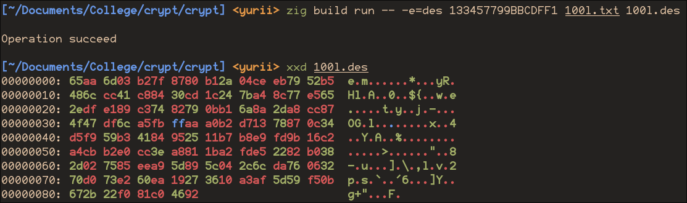
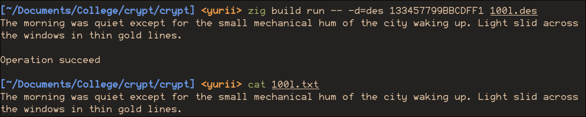
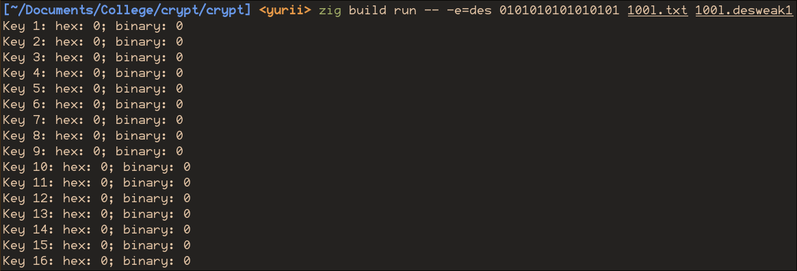
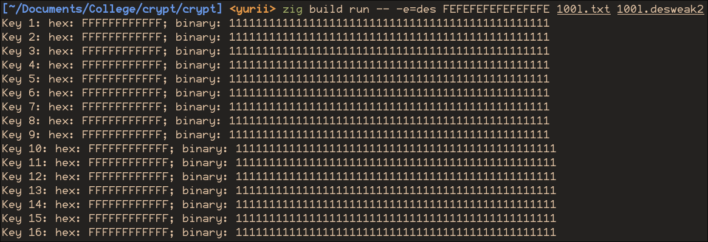
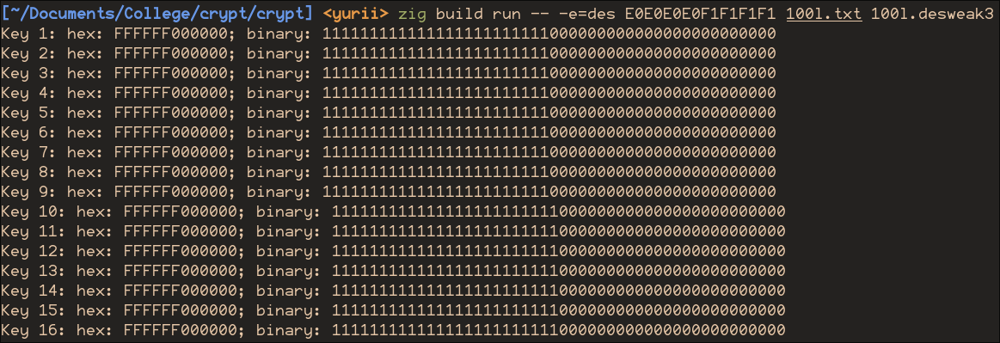
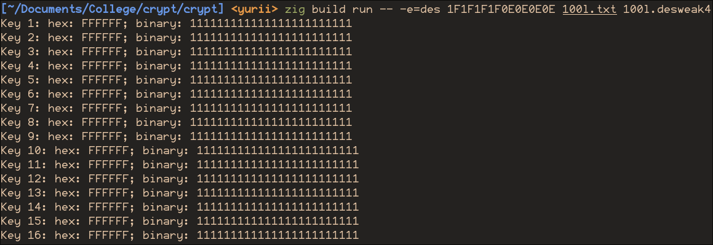
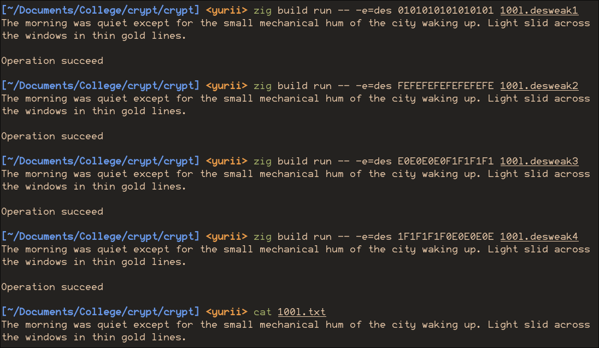

<!--
  Реалізація алгоритму DES
  Варіант 5: Перевірити чотири слабкі ключі з таблиці 2: вивести їхні підключі й показати, що подвійне шифрування повертає відкритий текст.

  Тему, мету й обладнання писати не треба — конвеєр візьме їх із лабораторної.
  Знімки екрана кладіть у assets/, вихідний код — у src/.
  Контрольні питання — лише одного рівня, того, на який захищаєте роботу:
  заголовок «### Достатній рівень», далі «1 Текст питання?» і відповідь.
  Покрокова інструкція — reports/README.md
-->

## Хід роботи

1. Отримати в викладача номер індивідуального варіанта.

2. Реалізувати функцію перестановки бітів за таблицею.

   ```zig
   fn permutate(src: anytype, comptime Dst: type, comptime tbl: anytype) Dst {
       const src_bits = @bitSizeOf(@TypeOf(src));
       const dst_bits = @bitSizeOf(Dst);
   
       if (tbl.len != dst_bits) @compileError("table length must equal destination bit width");
   
       var dst: Dst = 0;
       for (tbl, 1..) |pos, i| {
           const bit = (src >> @intCast(src_bits - pos)) & 1;
           dst |= @as(Dst, @intCast(bit)) << @intCast(dst_bits - i);
       }
       return dst;
   }
   ```

3. Реалізувати початкову перестановку IP та кінцеву IP⁻¹.

   ```zig
   /// Iterate over permutated blocks 64 bit length
   const BlockIter = struct {
       text: []const u8,
   
       pub fn init(text: []const u8) BlockIter {
           return .{.text = text};
       }
   
       pub fn next(it: *BlockIter) ?u64 {
           if (it.text.len == 0) return null;
   
           const srcv = it.text[0..@min(8, it.text.len)];
           it.text = it.text[srcv.len..];
   
           var src: u64 = 0;
           for (srcv, 1..) |byte, i| {
               src |= @as(u64, byte) << @intCast((8 - i) * 8);
           }
           return permutate(src, u64, IP);
       }
   };
   ```
   
4. Реалізувати розширення E (32 → 48 біт).

5. Реалізувати всі 8 S-блоків та функцію підстановки.

6. Реалізувати перестановку P.

7. Реалізувати генерацію 16 підключів (PC-1, циклічні зсуви, PC-2).

   ```zig
   fn getKey(key_str: []const u8) ?[16]u48 {
       const key64 = std.fmt.parseInt(u64, key_str, 16) catch |e| {
           std.debug.print("Error parsing intager: {t}\n", .{e});
           return null;
       };
   
       const k56 = permutate(key64, u56, &RIK);
       var c: u28 = @truncate(k56 >> 28);
       var d: u28 = @truncate(k56);
   
       var keys: [16]u48 = undefined;
       const shifts = [16]usize{1, 1, 2, 2, 2, 2, 2, 2, 1, 2, 2, 2, 2, 2, 2, 1};
   
       for (0..16) |i| {
           c = std.math.rotl(u28, c, shifts[i]);
           d = std.math.rotl(u28, d, shifts[i]);
           const cd = (@as(u56, c) << 28) | d;

           keys[i] = permutate(cd, u48, &RRK);
           // std.debug.print("Key {0}: hex: {1X}; binary: {1b}\n", .{i+1, keys[i]});
       }
   
       return keys;
   }
   ```

8. Реалізувати один раунд мережі Фейстеля.

   ```zig
   fn roundFn(key: u48, br: u32) u32 {
       // Extending br right half to 48 bits
       const ebr = permutate(br, u48, &E);
   
       // Key mixing
       const mixed = ebr ^ key;
   
       // Reducing each mixed 6bits to 4bits using round S-box
       var sbox: u32 = 0;
       for (0..8) |i| {
           const b6: u6 = @truncate(mixed >> @intCast(i * 6));
           const row: u2 = @intCast((((b6 >> 5) & 1) << 1) | (b6 & 0b1));
           const col: u4 = @truncate(b6 >> 1);
           sbox += @as(u32, S[i][row][col]) << @intCast(i * 4);
       }
   
       // S-box permutation
       sbox = permutate(sbox, u32, &P);
   
       return sbox;
   }
   ```

9. Реалізувати повний алгоритм шифрування (16 раундів + перестановки).

   ```zig
   pub fn crypt(decr: bool, key_str: []const u8, source: []const u8, sink: *Io.Writer) Io.Writer.Error!bool {
       const key = getKey(key_str) orelse return false;
   
       var it = BlockIter.init(source);
   
       while (it.next()) |block| {
           // Block halves
           var bl: u32 = @truncate(block >> 32);
           var br: u32 = @truncate(block);
   
           for (0..16) |round| {
               const tmp = br;
               br = bl ^ roundFn(key[if (decr) 16-round-1 else round], br);
               bl = tmp;
           }
   
           const res: u64 = (@as(u64, br) << 32) | bl; // Connect with transposition
           const unpermutated = permutate(res, u64, FP);
   
           try sink.writeInt(u64, unpermutated, .big);
       }
   
       return true;
   }
   ```

10. Реалізувати дешифрування (підключі у зворотному порядку).

    Так як у функції дешифрування змінюється лише порядок ключів, функція
    crypt об'єднує шифрування і дешифрування, змінюючи поведінку за флагом

   ```zig
   pub fn encrypt(key_str: []const u8, source: []const u8, sink: *Io.Writer) Io.Writer.Error!bool {
       return crypt(false, key_str, source, sink);
   }
   
   pub fn decrypt(key_str: []const u8, source: []const u8, sink: *Io.Writer) Io.Writer.Error!bool {
       return crypt(true, key_str, source, sink);
   }
   ```

11. Перевірити на тестовому векторі.

    

    

12. Виконати індивідуальне завдання згідно з варіантом.

    

    

    

    

    

13. Оформити звіт та зробити висновок.

## Відповіді на контрольні питання

1. Поясніть, як саме поєднання перестановок і підстановок 
   реалізує принципи розсіювання та перемішування Шеннона в DES.
   
   16 раундів змішування із ключем, s-блоків та перемішування роблять
   зв'язок між ключем, текстом та шифротекстом складним й нелінійним,
   роблячи частотний, диференційний та всі інші аналізи неможливими.
   
   Один раунд не дав би достатнього розсіювання (впливу зміни ключу на результат),
   тому важливо мати не менш ніж 16 раундів.
   
2. Оцініть, у скільки разів зросте стійкість, якщо збільшити 
   кількість раундів DES з 16 до 32. Що при цьому програємо?
   
   Так як при 16-ти раундах алгоритм вже настільки стійкий, що надійнішого методу
   ніж перебір ключів не знайшли, а збільшення раундів не збільшить ключ, то стійкість
   не зміниться.
   
   Це зробить алгоритм трохи повільнішим (що не буде помітно абсолютно ніяк на
   сучасному залізі)
   
3. Порівняйте DES і AES за довжиною ключа, структурою та швидкодією.
   Чому індустрія перейшла саме на AES?
   
   DES має 56-бітний ключ, AES - 128, 192, 256 бітні варіанти у офіційному стандарті,
   а так може мати і 512-бітний ключ, що робить Brute-force атаки на AES занадто повільними (поки що).
   
   DES використовує мережу фрейстеля (розбиття блоку на половини, шифрування однієї,
   змішування і перестановка половин), AES - мережу перемішувань і перестановок
   із раундами, кількість яких залежить від розміру ключа.
   
   DES із алгоритмічного погляду повинен бути швидшим, але сучасні процесори мають
   спеціальні прискорювачі AES алгоритму, що робить його не тільки надійнішим, а ще й
   швидшим.
   
4. Сформулюйте, за яких умов сьогодні ще припустимо застосовувати DES,
   і обґрунтуйте відповідь.
   
   На мою думку зараз використовувати DES нема ніякого сенсу. AES і надійніше, і швидше.
   І для будь-якого оточення ви точно знайдете вже реалізований AES.

## Висновок

Я зрозумів архітектуру алгоритму DES, яким чином мережа фрейстеля та S-блоки роблять його
криптографічно стійким забезпечуючи принципи дифузії та конфузії, реалізував
алгоритм практично.
