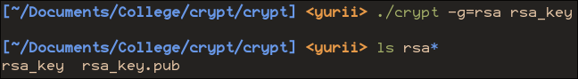
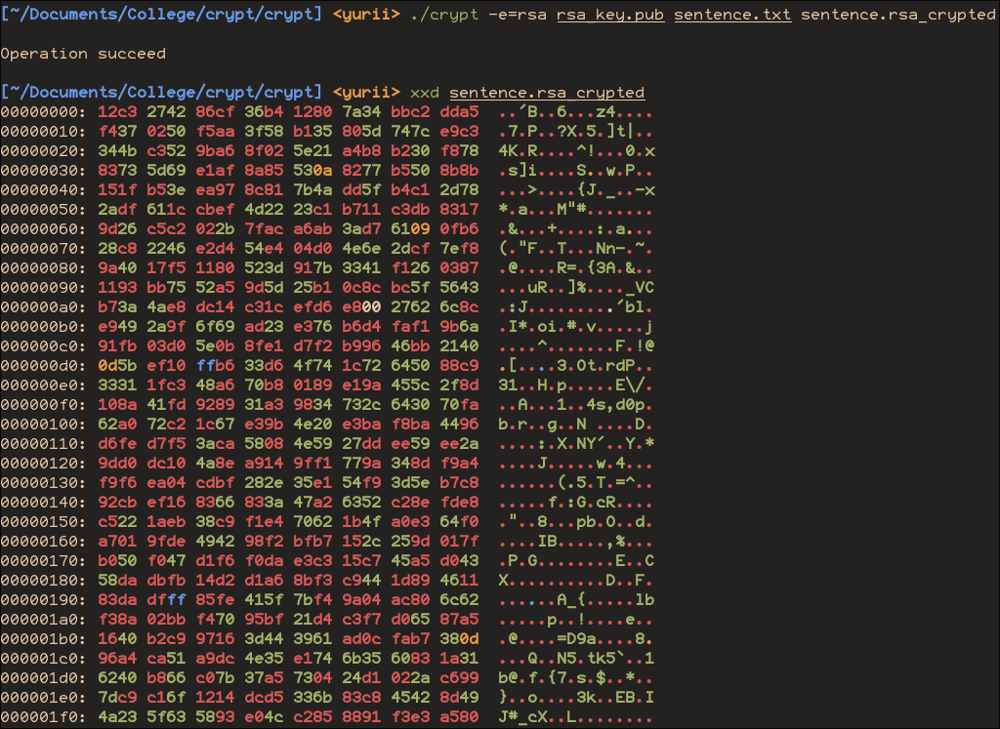
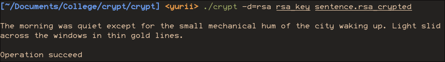

<!--
  Реалізація алгоритму RSA
  Варіант 5: p=97, q=101 — Порівняти час шифрування для e = 17, 257 і найбільшого допустимого e < φ(n). Чому e = 3 тут недопустиме і що важливіше для швидкості — величина e чи кількість одиниць у його двійковому записі?

  Тему, мету й обладнання писати не треба — конвеєр візьме їх із лабораторної.
  Знімки екрана кладіть у assets/, вихідний код — у src/.
  Контрольні питання — лише одного рівня, того, на який захищаєте роботу:
  заголовок «### Достатній рівень», далі «1 Текст питання?» і відповідь.
  Покрокова інструкція — reports/README.md
-->

## Хід роботи

1. Отримати в викладача номер індивідуального варіанта.

1. Реалізувати функцію обчислення НСД (алгоритм Евкліда).

1. Реалізувати розширений алгоритм Евкліда для знаходження оберненого за модулем.

   ```zig
   /// Find inversed intager in modular arithmetic
   /// (num * inversed(num)) % base == 1
   pub fn inversed(num: anytype, base: anytype) ?@TypeOf(num, base) {
       const T = @TypeOf(num, base);
   
       const ST = if (@typeInfo(T).int.signedness != .signed)
           @Int(.signed, @typeInfo(T).int.bits + 1)
       else
           T;
   
       const gcd, const x, _ = egcd(@as(ST, @mod(num, base)), @as(ST, base));
   
       return if (gcd == 1) @as(T, @intCast(@mod(x, base))) else null;
   }
   
   /// Extended Greatest Common Divisor
   /// s < b
   fn egcd(s: anytype, b: anytype) struct{@TypeOf(s, b), @TypeOf(s, b), @TypeOf(s, b)} {
       if (@typeInfo(@TypeOf(s, b)).int.signedness != .signed) {
           @compileError("egcd does not work with signed intagers");
       }
       if (s == 0) return .{b, 0, 1};
       assert(s < b);
   
       const gcd, const x1, const y1 = egcd(@mod(b, s), s);
       const x = y1 - x1 * @divTrunc(b, s);
       const y = x1;
       return .{gcd, x, y};
   }
   ```

1. Реалізувати швидке модульне піднесення до степеня (square-and-multiply).

   ```zig
   pub fn modPow(base: anytype, exp: anytype, mod: anytype) @TypeOf(base, exp, mod) {
       const T = @TypeOf(base, exp, mod);
       if (@typeInfo(T).int.signedness != .unsigned) {
           @compileError("Only unsigned type is supported");
       }
       const MT = @Int(.unsigned, @typeInfo(T).int.bits * 2); // Type for safe multiplying
   
       var res: T = 1;
       var b: T = base % mod;
       var e: T = exp;
   
       while (e > 0) {
           if (e & 1 == 1) {
               res = @intCast((@as(MT, res) * b) % mod);
           }
           e >>= 1;
           b = @intCast((@as(MT, b) * b) % mod);
       }
   
       return res;
   }
   ```

1. Реалізувати генерацію ключів RSA з простими числами з варіанта.

   Функція швидкої перевірки на просте число

   ```zig
   pub fn isPrime(num: anytype, random: std.Random) bool {
       if (num == 2 or num == 3) return true;
       if (num < 2 or num % 2 == 0) return false;
   
       // num-1 as 2^r * d
       var d = num - 1;
       var r: usize = 0;
       while (d % 2 == 0) : (r += 1) {
           d /= 2;
       }
   
       const test_rounds = 10;
   
       for (0..test_rounds) |_| {
           var x = modPow(random.intRangeAtMost(@TypeOf(num), 2, num-2), // [2; num-2]
                          d, num);
           if (x == 1 or x == num - 1) continue;
   
           const composite = find_composite: for (0..r-1) |_| {
               x = modPow(x, 2, num);
               if (x == num - 1) {
                   break :find_composite false;
               }
           } else true;
   
           if (composite) return false;
       }
       return true;
   }
   ```
   
   Функція генерації простих чисел
   
   ```zig
   pub fn genPrime(T: type, random: std.Random) T {
       const bits = @typeInfo(T).int.bits;
   
       while (true) {
           const candidate = random.intRangeAtMost(
               T, @as(T, 1) << (bits-1), ~@as(T, 0)
           ) | 1; // make odd
           if (isPrime(candidate, random)) return candidate;
       }
   }
   ```

   Функція генерація пари ключів
   
   ```zig
   pub fn genKeys(pub_sink: *Io.Writer, priv_sink: *Io.Writer) Io.Writer.Error!void {
       var rng = std.Random.DefaultPrng.init(
           @bitCast(@as(i64, @truncate(std.Io.Timestamp.now(global.io, .real).nanoseconds)))
       );
       const random = rng.random();
   
       // Generate 2 prime numbers
       const p = util.genPrime(Prime, random);
       var q = util.genPrime(Prime, random);
       while (q == p) q = util.genPrime(Prime, random);
   
       const n: Key = @as(Key, p) * q; // Part of public and private key
       const phi: Key = @as(Key, p - 1) * (q - 1);
   
       // Open exponent
       // var e: Key = 65537; // Part of public key
       // if (e >= phi) e = 17;
       // while (std.math.gcd(e, phi) != 1) e += 2;
   
       // Generate maximum size open exponent, embrase chaos!
       var e = phi - 1;
       while (std.math.gcd(e, phi) != 1) e -= 1;
   
       // The only private part of key
       // We have e as part of public key, so the only thing keeping us private is phi
       // for which to get from n we need to find its simple multipliers, which is very expensive,
       // so we must be safe.
       const d = util.inversed(e, phi).?; // Part of private key
   
       try pub_sink.writeInt(Key, n, .big);
       try pub_sink.writeInt(Key, e, .big);
   
       try priv_sink.writeInt(Key, n, .big);
       try priv_sink.writeInt(Key, d, .big);
   }
   ```
   
1. Реалізувати шифрування: C = M^e mod n.

   ```zig
   pub fn encrypt(pub_key: []const u8, source: []const u8, sink: *Io.Writer) Io.Writer.Error!bool {
       const n, const e = readKey(pub_key) orelse return false;
   
       var iter: BlockIter((@typeInfo(Key).int.bits / 8) / 2) = .init(source);
       while (iter.next()) |block| {
           const C: Key = util.modPow(@as(Key, block), e, n);
           try sink.writeInt(Key, C, .big);
       }
   
       return true;
   }
   ```
   
1. Реалізувати дешифрування: M = C^d mod n.

pub fn decrypt(priv_key: []const u8, source: []const u8, sink: *Io.Writer) Io.Writer.Error!bool {
    const n, const d = readKey(priv_key) orelse return false;

   ```zig
   pub fn decrypt(priv_key: []const u8, source: []const u8, sink: *Io.Writer) Io.Writer.Error!bool {
       const n, const d = readKey(priv_key) orelse return false;
   
       var iter: BlockIter(@typeInfo(Key).int.bits / 8) = .init(source);
       while (iter.next()) |block| {
           const P: Key = util.modPow(block, d, n);
           const Pblock = std.math.cast(Prime, P) orelse {
               print("Failed to cast intager to block size. Probably key is wrong\n", .{});
               return false;
           };
           try sink.writeInt(Prime, Pblock, .big);
       }
   
       return true;
   }
   ```

1. Перевірити роботу алгоритму на числовому прикладі.

1. Реалізувати шифрування текстового повідомлення.

   

   

   

1. Виконати індивідуальне завдання згідно з варіантом.

   

   

   

1. Оформити звіт та зробити висновок.


## Відповіді на контрольні питання

Високий рівень (творчий)

1. Поясніть, чому зростання довжини ключа RSA дає нелінійний приріст стійкості,
   і оцініть, чому 1024 біти вже вважають недостатніми.
   
   Основа RSA - складність розкладання числа на прості множники.
   Такий алгоритм є дуже складним, бо для цього потрібно не просто перебирати 
   ключі, а використовувати складну математику, тому й приріст стійкості від
   розміру ключа нелінійний - це не просто n нових значень для брут-форсу, а
   ціла поліада нових віток, які треба обчислити.
   
   Не дивлячись на це, комп'ютери стають все потужнішими, і ключ у 1024 бітів
   вже не вважається неможливим для розкладання, тому мінімум збільшується.

1. Запропонуйте порядок дій для безпечної генерації ключової пари в навчальній 
   лабораторії та поясніть роль джерела випадковості.
   
   1. Взяти реалізацію алгоритму
   2. Згенерувати ключі
   
   Роль джерела випадковості: якщо можливо визначити та відтворити, як були згенеровані
   числа для ключів, то це є великою вразливістю
   (наприклад, класично у C як зерно використовується поточний час у секундах,
   у такому випадку якщо хтось дізнається час генерації ключа, то він зможе його відтворити)

1. Порівняйте RSA й криптографію на еліптичних кривих за довжиною ключа, 
   швидкодією та поширеністю.
   
   --------------------------------------------------------
   Критерій     RSA Еліптичні криві (ECC)
   ------------ -------------------------------------------
   Розмір ключа Для приблизно 112 бітів стійкості — RSA-2048; для 128 — RSA-3072	Для приблизно 128 бітів — крива з параметром 256 бітів, наприклад P-256
   Швидкодія    Операції з відкритим ключем часто швидкі; генерація ключів і операції з приватним ключем можуть бути повільнішими, особливо зі збільшенням ключа	Ключі й підписи компактніші; швидкість залежить від конкретного алгоритму, кривої, бібліотеки та платформи
   Поширеність  Дуже широко використовується у наявних системах і сумісний із багатьма старими протоколами	Також широко поширена в сучасних протоколах; часто обирається, коли важливі менший розмір ключів і менше навантаження на мережу
   --------------------------------------------------------

1. Сформулюйте, які загрози для RSA створює поява квантових обчислень,
   і які напрями розв'язання цієї проблеми розвиваються.
   
   За рахунок магії квантової фізіки з'явився алгоритм, що може фактично безкоштовно
   розшифровувати RSA.
   
   Для розв'язання цієї проблеми зараз активно розробляються і починають застосовуватися
   нові алгоритми, стійкі до квантових комп'ютерів: ML-KEM, ML-DSA, SLH-DSA та інші
 
## Висновок

Я вивчив основні принципи асиметричного шифрування, практично реалізував їх
у вигляді алгоритму RSA
