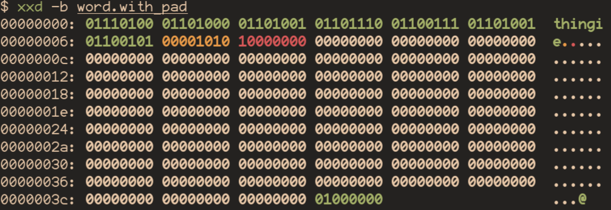
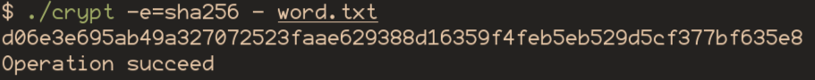
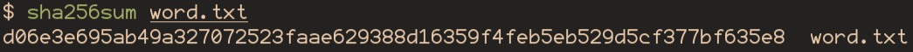
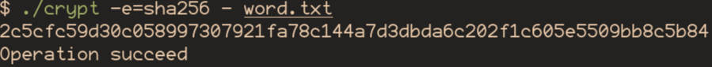
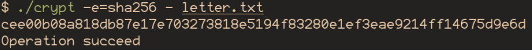
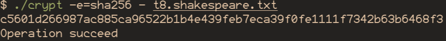

<!--
  Реалізація алгоритму SHA
  Варіант 5: Обчислити хеш файлу (прочитати побайтно). Перевірити, що навіть маленький файл дає 256-бітний хеш.

  Тему, мету й обладнання писати не треба — конвеєр візьме їх із лабораторної.
  Знімки екрана кладіть у assets/, вихідний код — у src/.
  Контрольні питання — лише одного рівня, того, на який захищаєте роботу:
  заголовок «### Достатній рівень», далі «1 Текст питання?» і відповідь.
  Покрокова інструкція — reports/README.md
-->

## Хід роботи


1 Отримати в викладача номер індивідуального варіанта.

| № | Завдання |
|----|----|
| 5 | Обчислити хеш файлу (прочитати побайтно). Перевірити, що навіть маленький файл дає 256-бітний хеш. |

2 Реалізувати клас SHA256 згідно з наведеним алгоритмом. Переконатися, що використовуються правильні типи даних (uint32_t для 32-бітних слів).

Zig не має класів

3 Реалізувати всі шість логічних функцій (Ch, Maj, Σ0, Σ1, σ0, σ1).

4 Реалізувати процедуру доповнення (padding) повідомлення. Перевірити на короткому тексті "abc".

```zig
fn padSource(source: []const u8) std.mem.Allocator.Error![]u8 {
    var blocks: usize = @divCeil(source.len, chunk_bytes);
    var after_end_bytes: usize = blocks * chunk_bytes - source.len;

    // Ensure to be enough bytes for length and padding
    if (after_end_bytes < tail_len_sz + 1) {
        blocks += 1;
        after_end_bytes += chunk_bytes;
    }

    // Text buffer with right len for length and etc
    const buf = try global.gpa.alloc(u8, blocks * chunk_bytes);
    errdefer global.gpa.free(buf);

    @memcpy(buf[0..source.len], source);

    // Add padding
    buf[source.len] = 0b10000000;
    @memset(buf[source.len+1..], 0);

    // Add length suffix. Length in bits
    const length = std.mem.nativeToBig(u64, @as(u64, source.len)*8);
    @memcpy(buf[buf.len-8..], @as([*]const u8, @ptrCast(&length)));

    return buf;
}
```



Є один біт та нулі після, розмір файлу кратний 512 бітам, довжина повідомлення
(thingie та нова лінія) = 8 = 64 біт = 0b01000000.

5 Реалізувати функцію обробки блоку (64 раунди). Звернути увагу на правильний порядок байтів (big-endian).

```zig
fn computeHash(buf: []const u8) [8]u32 {
    // Initial hash values
    // First 32 bits of the fractional parts of the square roots of the first 8 primes
    var hash = [8]u32{
        0x6a09e667, 0xbb67ae85, 0x3c6ef372, 0xa54ff53a, 0x510e527f, 0x9b05688c, 0x1f83d9ab, 0x5be0cd19,
    };

    // Iterate over chunks
    for (0..buf.len/chunk_bytes) |chnk_i| {
        var w: [64]u32 = @splat(0); // Message schedule

        // Copy first 16 words from chunk
        for (0..16) |word_i| {
            w[word_i] = std.mem.readInt(u32, buf[chnk_i*chunk_bytes + word_i*4..][0..4], .big);
        }
        // Extend 16 words to 63 words
        for (16..64) |i| {
            const s0 = rotr(u32, w[i-15], 7) ^ rotr(u32, w[i-15], 18) ^ (w[i-15] >> 3);
            const s1 = rotr(u32, w[i-2], 17) ^ rotr(u32, w[i-2], 19)  ^ (w[i-2] >> 10);
            w[i] = w[i-16] +% s0 +% w[i-7] +% s1;
        }

        var h = hash; // compressed chunk, start from current hash

        // Compression loop
        for (0..64) |i| {
            const s1 = rotr(u32, h[4], 6) ^ rotr(u32, h[4], 11) ^ rotr(u32, h[4], 25);
            const ch = (h[4] & h[5]) ^ (~h[4] & h[6]);
            const temp1 = h[7] +% s1 +% ch +% k[i] +% w[i];

            const s0 = rotr(u32, h[0], 2) ^ rotr(u32, h[0], 13) ^ rotr(u32, h[0], 22);
            const maj = (h[0] & h[1]) ^ (h[0] & h[2]) ^ (h[1] & h[2]);
            const temp2 = s0 +% maj;

            h = [8]u32{
                temp1 +% temp2,
                h[0],
                h[1],
                h[2],
                h[3] +% temp1,
                h[4],
                h[5],
                h[6],
            };
        }
        // Add compressed chunk to final result
        hash[0] +%= h[0];
        hash[1] +%= h[1];
        hash[2] +%= h[2];
        hash[3] +%= h[3];
        hash[4] +%= h[4];
        hash[5] +%= h[5];
        hash[6] +%= h[6];
        hash[7] +%= h[7];
    }
    return hash;
}
```

6 Перевірити реалізацію на трьох офіційних тестових векторах NIST.





Сума, видана моєю реалізацією та стандартною утілітою повністю співпадають

7 Продемонструвати лавинний ефект: обчислити хеші двох повідомлень, що відрізняються на один символ. Порахувати, скільки біт змінилося у хеші.



Хеш-сума змінилася радикально

8 Виконати індивідуальне завдання згідно з варіантом.





У обох випадках хеш-сума складає 256 бітів

9 Оформити звіт та зробити висновок. 

## Відповіді на контрольні питання

### Високий рівень (творчий)

**1** Поясніть, чому довжина повідомлення обов'язково входить у доповнення, 
і яку атаку це унеможливлює.

Єдина функція додавання довжини повідомлення полягає у тому, щоб
забопігти ситуації, коли два різних повідомлення стають однаковими
після розширення. Це не запобігає ніяким атакам.

**2** Оцініть, скільки спроб у середньому потрібно для пошуку колізії 
SHA-256 за парадоксом днів народження, і що це означає практично.

За парадоксом днів народження крива розподілу ймовірності колізії
надає вибуховий рост на початку - середині, а потім дуже повільний рост вкінці.

Практично це означає, що хоча кількість хешів для sha256 = 2^256, вже
2^128 спроб дають ~50% шанс знайти колізію, а 2^129 дають біля 80%.

У реальності це не є великою проблемою, так як навіть перебір 2^129 комбінацій
є непосильною задачею для сучасних комп'ютерів.

**3** Запропонуйте схему перевірки цілісності великого архіву файлів 
на основі хешування. Обґрунтуйте вибір структури.

tar архіви кодують вміст по кусках по 512 біт, вміст вільного простору яких не стандартезовано.
Відповідно ми можемо знайти і порівняти хеш кожного архівованого файлу
із хешем цього файлу у архіві дуже просто майже без додаткових маніпуляцій.

**4** Сформулюйте критерії, за якими обирають хеш-функцію для нової системи, 
і поясніть, чому «найновіша» не завжди означає «найкраща».

Основні критерії хеш функції:

- Стійкість до колізії
- Швидкість (не обов'язково найшвидша - найкраща)

Так як хеш функція зазвичай є ядром безпеки, і її компромація буде
великою дірою у системі, зазвичай перевагу надають перевіреним часом
функціям над новими, ще не так гарно дослідженими на вразливості.

## Висновок

Я вивчив принципи хешування, яким чином працюють хеш функції та реалізував
алгоритм sha256 сімейства sha-2.
