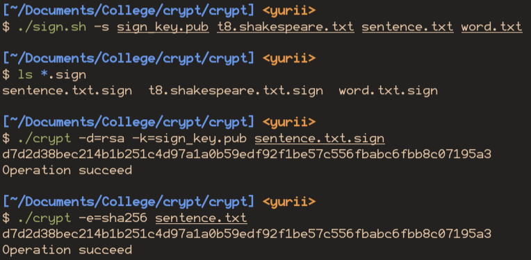
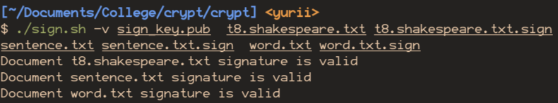
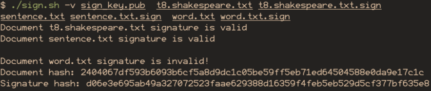

<!--
  Реалізація ЕЦП на основі RSA
  Варіант 5: p=97, q=101 — Реалізувати пакетну верифікацію кількох підписів. Скільки операцій потребується?

  Тему, мету й обладнання писати не треба — конвеєр візьме їх із лабораторної.
  Знімки екрана кладіть у assets/, вихідний код — у src/.
  Контрольні питання — лише одного рівня, того, на який захищаєте роботу:
  заголовок «### Достатній рівень», далі «1 Текст питання?» і відповідь.
  Покрокова інструкція — reports/README.md
-->

## Хід роботи

1) Отримати в викладача номер індивідуального варіанта.

Таблиця 1 – Індивідуальне завдання

| № | Прості числа (p, q) | Додаткове завдання |
|----|----|----|
| 5 | p=97, q=101 | Реалізувати пакетну верифікацію кількох підписів. Скільки операцій потребується? |

2) Реалізувати генерацію ключової пари RSA. Використати прості числа з варіанта.

З лр №6

3) Реалізувати функцію хешування повідомлення. Можна використати бібліотечну SHA-256 або власну реалізацію з попередньої роботи.

З лр №7

4) Реалізувати функцію формування підпису: S = H(M)^d mod n.

5) Реалізувати функцію перевірки підпису: порівняння H(M) та S^e mod n.

6) Продемонструвати коректну верифікацію підписаного документа.

7) Продемонструвати виявлення модифікації — змінити документ і показати, що підпис став недійсним.

8) Продемонструвати захист від підробки — змінити підпис і показати, що верифікація не проходить.

9) Виконати індивідуальне завдання згідно з варіантом.

10) Оформити звіт та зробити висновок. 

**Лістинг**

```shell
#!/bin/sh

# With rsa you encrypt with public key and decrypt with private
# With signature you sign with private key and check with public
# So only you can encrypt, but anyone can decrypt signature and check it

MODE=""

while getopts ':hsv' opt; do
    case $opt in
        h) printf "%s\n" "Usage: $(basename "$0") [-h] <-s <key> <document> <out>|-v <key> <signature>>"
           printf "\t%s\n" "-h: show help and exit"
           printf "\t%s\n" "-s <key> <document...>: sign documents with private key"
           printf "\t%s\n" "-v <key> <document> <signature> ...: verify document signatures"
           exit
           ;;
        s) MODE="sign" ;;
        v) MODE="verify" ;;
        *) printf "%s\n" "$(basename "$0"): $optopt: no such argument" >&2
           exit 1
           ;;
    esac
done

shift $((OPTIND - 1))

# echo "N Args: $#"
# echo "Args: $@"

case "$MODE" in
    "sign")
        if [ $# -lt 2 ]; then
            printf "Not enough arguments for signing" >&2
            exit 1
        fi
        key="$1"
        shift

        while [ $# -gt 0 ]; do
            doc="$1"
            shift

            # Find hash and sign with key
            (./crypt -e=sha256 "$doc" | ./crypt -e=rsa -k="$key" - "$doc.sign") 2>/dev/null
        done
        ;;
    "verify")
        if [ $# -lt 3 ]; then
            printf "Not enough arguments for signing" >&2
            exit 1
        fi
        key="$1"
        shift

        while [ $# -gt 1 ]; do
            doc="$1"
            sign="$2"
            shift 2

            hash="$(./crypt -e=sha256 "$doc" 2>/dev/null)"
            sign_hash="$(./crypt -d=rsa -k="$key" "$sign" 2>/dev/null | tr -d '\000')"

            if [ "$hash" = "$sign_hash" ]; then
                echo "Document $doc signature is valid"
            else
                echo
                echo "Document $doc signature is invalid!"
                echo "Document hash: $hash"
                echo "Signature hash: $sign_hash"
                echo
            fi
        done
        ;;
esac
```

**Тестування**







## Відповіді на контрольні питання

### Високий рівень (творчий)

1) Поясніть повний ланцюжок довіри: від сертифіката користувача до кореневого центру сертифікації. Де саме він може розірватися?

1. Центр сертифікації видає користувачу приватний ключ та зберігає публічний 
   (або користувач генерує ключі і завантажує публічний у центр)
2. Користувач підписує документи отриманим приватним ключем
3. Той, хто перевіряє отримує публічний ключ із центру і перевіряє їм

Якщо центр підмінить публічний ключ, то не буде можливості верифікувати підпис документу.

2) Скомпрометовано закритий ключ, яким за рік підписано сотні документів. Опишіть порядок дій і поясніть роль списку відкликаних сертифікатів.

Треба відкликати публічний ключ із серверу. 
Якщо формат підпису передбачає збереження дати підписання, 
обмежити дію ключа до документів, що були підписані до компрометації.

Створитит нові ключі й перепідписати їми усі документи, що були підписані
у період із компромації старого ключа.

3) Порівняйте ЕЦП на основі RSA та на основі еліптичних кривих за розміром підпису, швидкодією та поширеністю.

Таблиця 2 – Порівняння RSA та еліптичних кривих

| Критерій       | RSA | Еліптичні криві (зазвичай ECDSA) |
|----------------|-----|----------------------------------|
| Розмір підпису | Приблизно дорівнює довжині RSA-модуля: RSA-2048 дає підпис 256 байтів, RSA-3072 — 384 байти | Компактніший: для ECDSA P-256 — близько 70 байтів у DER-кодуванні або 64 байти як конкатенація r і s |
| Швидкодія      | Перевірка підпису  швидка; створення підпису й генерування ключів повільніше | Створення підпису швидше; перевірка повільніша за RSA |
| Поширеність    | Широка сумісність, зокрема зі старими системами | Широко підтримується сучасними платформами; у застарілих системах сумісність може бути гіршою |

4) Сформулюйте, чим юридично значущий підпис відрізняється від технічно коректного, і які вимоги додає законодавство.

Технічно коректний підпис: той, що технічно вірно працює і відповідає криптографічним вимогам

Юридично значущий підпис: той, що офіційно закріплений за певною особою чи організацією, і 
має юридичну силу, рівну до ручного підпису. Якщо документ підписаний таким підписом, то
це підтверджує не лише його цілісність й автентичність, а й його юридичну силу.

## Висновок

Я вивчив концепт цифрових підписів, яким чином створювати та верефікувати RSA підпис.
