<!--
  Програмні засоби захисту від мережевих атак
  Варіант 5: 135 (RPC) — 3389 (RDP) — Порівняти HTTP та HTTPS трафік. Що видно в кожному?

  Тему, мету й обладнання писати не треба — конвеєр візьме їх із лабораторної.
  Знімки екрана кладіть у assets/, вихідний код — у src/.
  Контрольні питання — лише одного рівня, того, на який захищаєте роботу:
  заголовок «### Достатній рівень», далі «1 Текст питання?» і відповідь.
  Покрокова інструкція — reports/README.md
-->

## Хід роботи

1 Отримати в викладача номер індивідуального варіанта.

2 Аналіз мережевого трафіку:

- Встановити Wireshark (якщо не встановлено)
- Запустити захоплення трафіку на основному інтерфейсі
- Відвідати кілька веб-сайтів (HTTP і HTTPS)
- Знайти та проаналізувати HTTP-запити
- Застосувати фільтри для виділення трафіку

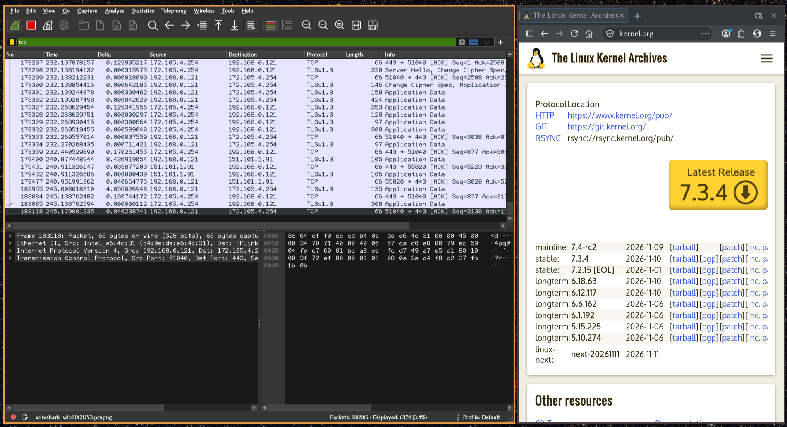

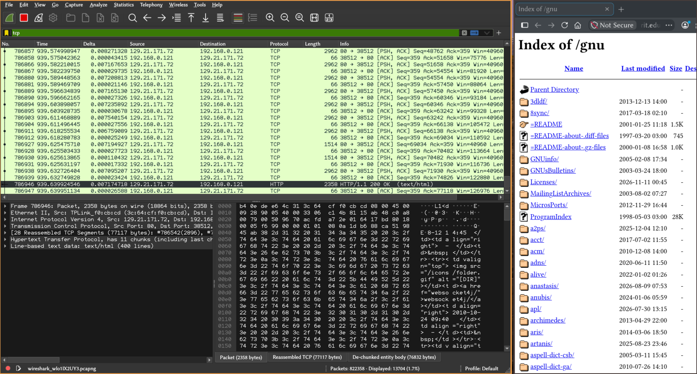

Як видно, http трафік не зашифровано, і html документ, що він передав можна
легко передивитися у змісті паекту

3 Налаштування брандмауера:

- Переглянути поточні правила брандмауера
- Створити правило для блокування порту з варіанта
- Створити правило для дозволу порту з варіанта
- Перевірити роботу правил
- Видалити тестові правила

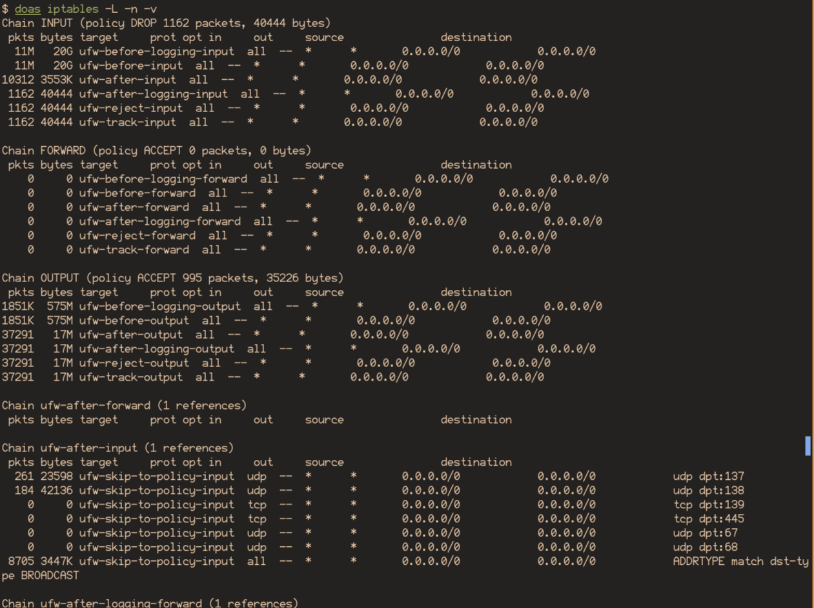

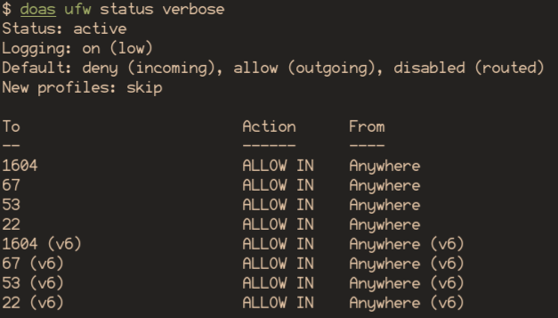

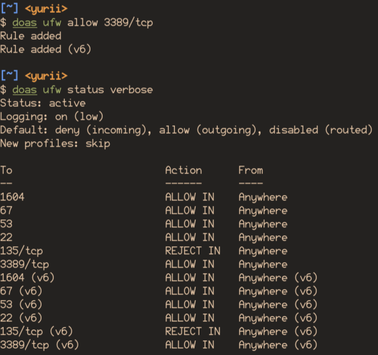

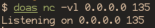

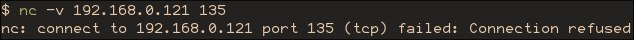

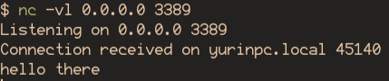

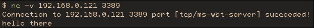

4 Сканування портів:

- Визначити відкриті порти на localhost
- Ідентифікувати процеси, що прослуховують порти
- Записати результати

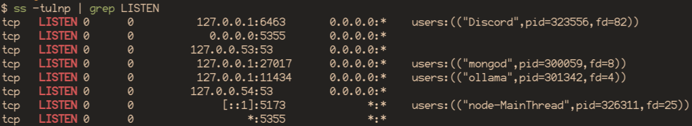

5 Захист веб-застосунку:

- Запустити демонстраційний код SQL-ін'єкції
- Продемонструвати успішну атаку на вразливий код
- Продемонструвати блокування атаки безпечним кодом
- Повторити для XSS

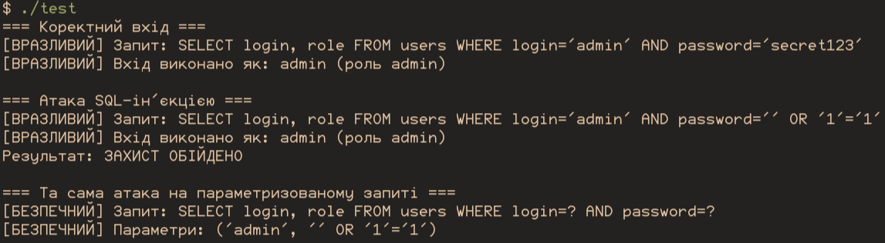

6 Виконати індивідуальне завдання згідно з варіантом.

7 Оформити звіт та зробити висновок.

## Відповіді на контрольні питання

### Високий рівень (творчий)

1 Побудуйте ешелоновану схему захисту веб-застосунку:
які засоби на якому рівні та проти яких загроз працюють.

1. ОС: використовувати надійну операційну систему 
   (OpenBSD чи hardened linux для критичних застосунків, звичайний linux чи bsd як стандарт)
2. Оточення: firewall, fail2ban, ssh, nginx та інші речі, що не прив'язуються напряму до
   програми, але при правильному налаштуванні надає кращий захист
3. Рівень програми: використовувати надійні технології як основу (точно не PHP та JavaScript),
   якщо потрібна більша швидкість, то надавати перевагу memory-safe мовам (go, rust, ...).
   Використовувати перевірені бібліотеки та фреймворки, мінімізувати кількість залежностей,
   розглянути можливість vendor-locking.
4. Архітектура: передбачити авторизацію, надійне зберігання паролів, використовувати
   базу даних таким чином, щоб sql ін'єкції не були проблемою.

2 Система виявлення вторгнень дає багато хибних спрацьовувань. 
Назвіть причини та порядок налаштування, щоб їх зменшити без втрати чутливості.

Тому що такі системи працюють по певним евристичним алгоритмам. 
Наприклад блокування ip адресс, що надсилають занадто багато
запитів. Але такий трафік може бути результатом багатьох
інших факторів окрім спроби атаки.

Ручний аналіз трафіку на вже запущеному сервесі та відповідний підгін
конфігурації може зменшити кількість хибних спрацювань, але усеодно не усунути проблему повністю.

3 Оцініть, чому повне блокування вхідного трафіку 
не є універсальним розв’язанням, і сформулюйте критерій відкриття порту.

Як мінімум тому, що інтернет-сервіс, що блокує весь вхідний трафік
не зможе нічого робити. Щось треба відкривати для надання функціоналу.
Відкривати порти треба по принциму мінімально необхідного об'єму:
заблокувати все, а потім додавати виключення у firewall для потрібних ресурсів.

4 Сформулюйте, чому більшість успішних атак використовує не технічні вразливості,
а помилки конфігурації та людський фактор. Проілюструйте прикладами з роботи.

Тому що станом на зараз software частина є достатньо надійною, щоб атака на пряму
вразливість була надто складною чи взагалі неможливою. Люди ж, які налаштовують
та використовують сервіси не завжди можуть захистити та зробити усе правильно,
тому такі атаки значно простіші. 

Більшість великих відомих атак більше про соціальний інженеринг, ніж про комп'ютерний.

Із появою та широкою інтеграцією AI зараз він став найвразливішою ланкою, але людський
фактор все ще досить критична частина.

## Висновок

Я зрозумів, чому наявність https є критичною для безпеки, як можна налаштовувати правила firewall-у,
як ідентифікувати процеси, що займають сокети у системі та принцип SQL-ін'єкцій.
