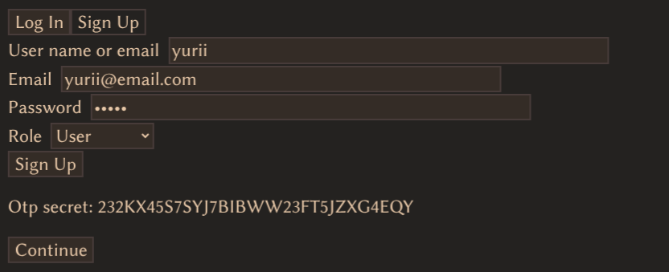
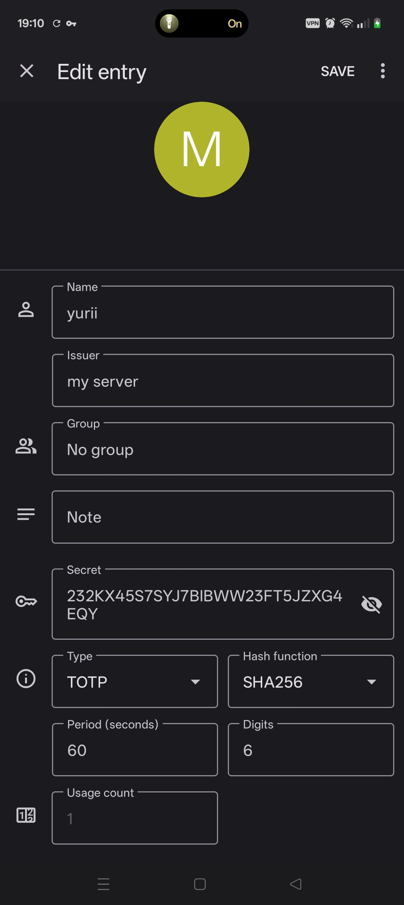
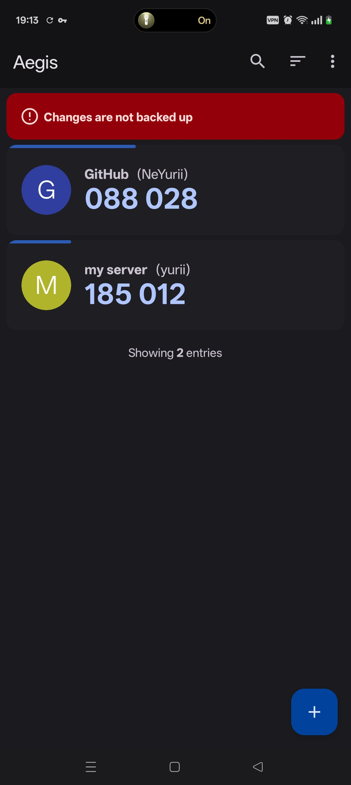
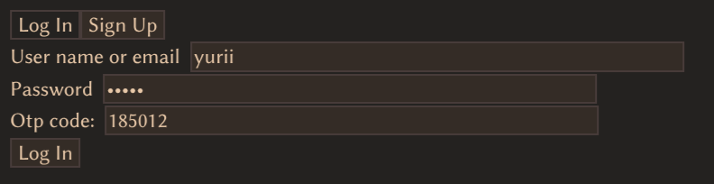

<!--
  Ідентифікація та аутентифікація користувачів
  Варіант 5: Реалізувати HOTP (counter-based) замість TOTP.

  Тему, мету й обладнання писати не треба — конвеєр візьме їх із лабораторної.
  Знімки екрана кладіть у assets/, вихідний код — у src/.
  Контрольні питання — лише одного рівня, того, на який захищаєте роботу:
  заголовок «### Достатній рівень», далі «1 Текст питання?» і відповідь.
  Покрокова інструкція — reports/README.md
-->

## Хід роботи


1 Отримати в викладача номер індивідуального варіанта.

2 Реєстрація користувача:

- Реалізувати генерацію криптографічно безпечної солі
- Реалізувати хешування пароля з сіллю (SHA-256 або PBKDF2)
- Продемонструвати, що однакові паролі з різною сіллю дають різні хеші

3 Перевірка пароля:

- Реалізувати функцію перевірки пароля
- Використати constant-time порівняння хешів
- Продемонструвати захист від timing attacks

4 Challenge-Response:

- Реалізувати протокол виклик-відповідь
- Продемонструвати успішну аутентифікацію
- Продемонструвати захист від replay-атак

5 TOTP:

- Реалізувати генерацію TOTP-кодів
- Перевірити сумісність з Google Authenticator (опціонально)
- Продемонструвати повний цикл 2FA (пароль + TOTP)

6 Виконати індивідуальне завдання згідно з варіантом.

7 Оформити звіт та зробити висновок.
 
Генерація паролі та OTP секрету при створенні користувача

```go
func (api *Api) newUser(user userStruct) error {
        if len(user.Email) == 0 {return errNoEmail}
        if len(user.Name) == 0 {user.Name = user.Email}

        if len(user.Pass) == 0 {return errNoPassword}
        if len(user.Role) == 0 {
                user.Role = RoleUser
        } else if _, ok := roleRights[user.Role]; !ok {
                return errUnknownRole;
        }

        var err error
        user.PassHash, err = hashPassword([]byte(user.Pass))
        user.Pass = ""

        user.TotpCode = base32.StdEncoding.WithPadding(base32.NoPadding).EncodeToString(
                binary.AppendUvarint(
                        binary.AppendUvarint([]byte{}, api.rng.Uint64()),
                        api.rng.Uint64(),
                ),
        )

        err = api.db.Create("users", user)
        if errors.Is(err, minidb.ErrAlreadyExists) {err = errUserExists}
        return err
}

mux.Handle("POST /api/users", util.WithTypes("", "application/json",
        util.HandlerEFunc(api.handleSignup)))

func (api *Api) handleSignup(w http.ResponseWriter, r *http.Request) error {
        vals := readFormOrJson(r, []string{"login", "email", "password", "role"})
        newUser := userStruct{
                Name: vals[0],
                Email: vals[1],
                Pass: vals[2],
                Role: vals[3],
        }

        tok, totpSecret, err := api.performSignup(newUser)
        if err != nil {return err}

        http.SetCookie(w, makeCookie(tok))
        w.WriteHeader(http.StatusCreated)

        return json.MarshalWrite(w, struct{
                TotpSecret string `json:"totp_secret"`
        }{totpSecret})
}
```

Реєстрація на клієнтській частині

```javascript
async function doSignup(formData) { // throws
    const res = await fetch("/api/users", { method: "POST", body: formData });
    const resJson = await res.json();
    return resJson.totp_secret
}
```

Challenge-response логін

```go
// This definetly should not map to login
var challenges map[string]string = make(map[string]string)
var otps map[string]otpQue = make(map[string]otpQue)
type otpQue struct {
        code string
        uid  bson.ObjectID
}

type challengeInfo struct {
        Random string `json:"random"`
        Salt   string `json:"salt"`
}

func (api *Api) loginChallenge(login string) (info challengeInfo, err error) {
        if len(login) == 0 {err = errEmptyLogin; return}

        info.Random = strconv.FormatUint(api.rng.Uint64(), 16)
        challenges[login] = info.Random;

        // Find user
        dbUser, err := api.findUserByLogin(login, errWrongLogin)
        if err != nil {return}

        // Getting salt form hashed password
	p, err := bcrypt.NewFromHash(dbUser.PassHash)
	if err != nil {return}

        info.Salt = fmt.Sprintf("$%c%c$%d$%s",
                p.Major, p.Minor, p.Cost, string(p.Salt))

        return
}

func (api *Api) checkChallenge(login string, resp string) (string, error) {
        if len(login) == 0 {return "", errEmptyLogin}
        if len(resp) == 0 {return "", errEmptyPassword}

        // Find challenge generated before
        challenge, ok := challenges[login]
        if !ok {return "", errNoChallange}

        // Find user
        dbUser, err := api.findUserByLogin(login, errWrongLogin)
        if err != nil {return "", err}

        // Check expected result with returned by clent
        hmac := append([]byte(challenge), dbUser.PassHash...)
        expected := fmt.Sprintf("%x", sha256.Sum256(hmac))

        if !reflect.DeepEqual(expected, resp) {return "", errWrongPassword}

        delete(challenges, login)

        // Consider this a migration strategy
        if dbUser.TotpCode == "" {
                return makeToken(dbUser.ID)
        } else {
                otps[login] = otpQue{code: dbUser.TotpCode, uid: dbUser.ID}
                return "", errNeed2FA
        }
}

mux.Handle("QUERY /api/challenge",
        util.WithTypes("", "application/json",
                util.HandlerEFunc(api.handleLoginChallenge)))
mux.Handle("POST /api/challenge",
        util.HandlerEFunc(api.handleChallengeResponse))

// Accepts login only, returns challenge bytes returned as hex string
func (api *Api) handleLoginChallenge(w http.ResponseWriter, r *http.Request) error {
        login := readLogin(r)

        info, err := api.loginChallenge(login)
        if err != nil {return err}

        return json.MarshalWrite(w, info)
}

// Check challengle response. The password is challenge result
func (api *Api) handleChallengeResponse(w http.ResponseWriter, r *http.Request) error {
        login, password := readLoginPassword(r)

        tok, err := api.checkChallenge(login, password)
        if err != nil {return err}

        http.SetCookie(w, makeCookie(tok))
        return nil
}
```

На клієнті

```javascript
async function loginChallenge(formData) { // throws
    const login = formData.get("login");
    const password = formData.get("password");

    // Get challenge
    let res = await apiSendJson("/challenge", { method: "QUERY", body: {
        login: login,
    }});
    if (!res.ok) throw new Error(`Server error: ${res.status}: ${await res.text()}`);
    const resJson = await res.json();

    // Find hash of password
    const passHash = (await bcrypt.hash(password, resJson.salt));

    // Compute challenge
    const hmac = new TextEncoder().encode(resJson.random + passHash);
    const resp = new Uint8Array(
        await window.crypto.subtle.digest("SHA-256", hmac)
    );

    // Login with solved challenge
    res = await apiSendJson("/challenge", { method: "POST", body: {
        login: login,
        password: resp.toHex(),
    }});
    if (!res.ok) throw new Error(`Server error: ${res.status}: ${await res.text()}`);
    return res.status === 202
}
```

Перевірка otp ключа

```go
func loginOtp(login, passCode string) (string, error) {
        info, ok := otps[login]
        if !ok {return "", errWrongLogin}

        opts := totp.ValidateOpts {
                Period: 60, // seconds
                Skew: 0,
                Digits: 6, // 6 or 8
                Algorithm: otp.AlgorithmSHA256,
        }

        valid, err := totp.ValidateCustom(passCode, info.code, time.Now().UTC(), opts)
        if err != nil {return "", err}
        if !valid {return "", errWrongPassword}

        return makeToken(info.uid)
}

func (api *Api) handleTotpResponse(w http.ResponseWriter, r *http.Request) error {
        // Password name is universal enough to be password, challenge response and otp key
        login, password := readLoginPassword(r)

        tok, err := loginOtp(login, password)
        if err != nil {return err}

        http.SetCookie(w, makeCookie(tok))
        return nil
}

mux.Handle("POST /api/otp",
        util.HandlerEFunc(api.handleTotpResponse))
```

Клієнтська частина

```javascript
async function loginOtp(formData) { // throws
    const res = await apiSendJson("/otp", { method: "POST", body: {
        login: formData.get("login"),
        password: formData.get("otp"),
    }});
    if (!res.ok) throw new Error(`Server error: ${res.status}: ${await res.text()}`);
}
```

Результати:









## Відповіді на контрольні питання

### Високий рівень (творчий)

1 Спроєктуйте схему аутентифікації для навчального порталу: 
які фактори, як зберігаються паролі, як відбувається відновлення доступу.
Обґрунтуйте кожне рішення.

Ідеальнмм варіантом для навчального порталу було б використання Oauth 2 для
використання google чи github чи іншого сервісу для входу, так як це:
1. Досить безпечно
2. Легше в підтримці
3. Люди занадто ліниві для того щоб створювати нові акаунти

Але мати стандартну систему, як запасний варіант, завжди гарно. 
Усе одно можна використати вже готові рішення, впевнившись у їх надійності,
додати 2-х етапну авторизацію, і обов'язково передбачити можливість скидання 
паролів.

2 Базу хешів паролів викрадено. Опишіть порядок дій адміністратора та поясніть,
від чого саме захистили сіль і повільна функція.

По перше сповістити користувачів про інцедент і заставити змінити пароль.

Якщо система мала захешовані сучасними алгоритмами паролі, то із цією
базою товком нічого не зробить (тим більше якщо користувачі мають 2fa),
так як підбір паролів може зайняти тисячоріччя.

Навіть якщо один пароль буде підібрано, інші (навіть якщо самі паролі такі самі)
залишаться невідомими для зловмисників завдяки солі.

3 Оцініть, чому збільшення вимог до складності пароля має межу корисності, 
і запропонуйте, чим його доцільніше замінити.

Тому що хеш суми завжди одного розміру і через це мають обмежений набір 
можливих значень. Навіть якщо пароль буде 500 символів у довжину та включати
символи грузинського алфавіту, але захешований у md5, то знайти його методом перебору
буде не складніше ніж пароль на 10 символів із буквами та цифрами.

Складність паролю може захистити від перебору по базі паролів, але не від
слабкості хеш функції. Відповідно для покращення стійкості варто використовувати
стійкішу функцію

4 Сформулюйте, чому багатофакторність підвищує безпеку не вдвічі, а на порядок,
і за яких умов цей виграш зникає.

Двофакторність змушує зловмисника перехопити дві незалежні сутності, які навіть
поодинці складні. Якщо зловмисник якось дістав пароль, то тепер йому ще треба
якимось чином перехопити смс, чи навпаки, зловмисник побачив смс, але пароль надійно захешований і 
не передається по мережі, а користувач вже помітив підозрілу активність.

Але якщо другий фактор не є іншим типом авторизації, наприклад пароль та секретна
фраза, тоді це не додає особливої стійкості, так як зловмиснику все ще потрібно
отримати одну сутність, просто 2 рази (наприклад якщо був виток бази, то там
будуть і паролі, і секретні фрази)

## Висновок

Я вивчив як створювати системи із безпечною авторизацією використовуючи
стандарт шифрування bcrypt із генерацією солі та константним часом обчислення паролю,
challenge-response протокол входу без передачі паролю по інтернету та двофакторну
автентифікацію використовуючи одноразові паролі у клієнт-серверному застосунку.
